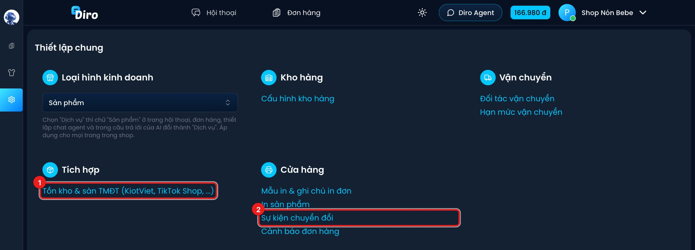

# Tích hợp

Diro kết nối với các phần mềm và nền tảng bạn đang dùng, để bạn quản lý mọi thứ ở một nơi.

Vào **Thiết lập** của trang:

1. **Tồn kho & sàn TMĐT (KiotViet, TikTok Shop, …)**: mở trang Tích hợp.
2. **Sự kiện chuyển đổi** (trong nhóm Cửa hàng): thiết lập gửi sự kiện đơn hàng về Facebook.

## Các trang trong mục này

- [TikTok Shop](./tiktok-shop.md): đưa đơn TikTok Shop về Diro.
- [KiotViet](./kiotviet.md): tự cập nhật trạng thái hết hàng từ tồn kho KiotViet.
- [Sự kiện chuyển đổi Facebook](./su-kien-chuyen-doi.md): báo cho Facebook biết đơn nào đã
  chốt để tối ưu quảng cáo.

Sapo và Haravan đang ở trạng thái **Sắp ra mắt**.
