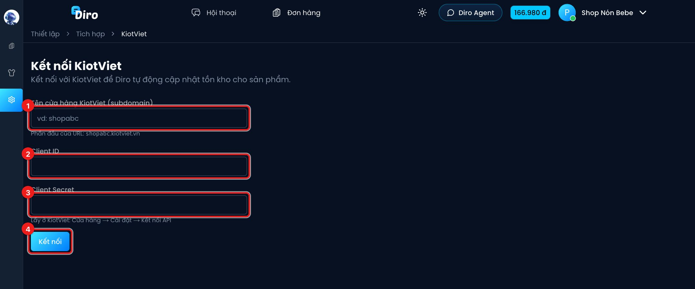

# KiotViet

Nếu bạn quản lý kho bằng KiotViet, hãy kết nối để Diro **tự đánh dấu hết hàng / còn hàng** cho
sản phẩm theo tồn kho thật. Khi một mã hết hàng trên KiotViet, sản phẩm tương ứng trên Diro
cũng chuyển sang hết hàng, bạn không phải bật tắt bằng tay.

## Bước 1: Lấy thông tin kết nối trên KiotViet

Trên KiotViet, vào **Cửa hàng → Cài đặt → Kết nối API** để lấy **Client ID** và **Client Secret**.
Ghi lại cả **tên cửa hàng**, là phần đầu địa chỉ KiotViet của bạn: với `shopabc.kiotviet.vn` thì
tên cửa hàng là `shopabc`.

## Bước 2: Kết nối trên Diro

Vào **Thiết lập → Tồn kho & sàn TMĐT**, ở thẻ **KiotViet** bấm **Kết nối**.

1. **Tên cửa hàng KiotViet (subdomain)**: ví dụ `shopabc`.
2. **Client ID**.
3. **Client Secret**.
4. Bấm **Kết nối**.

## Bước 3: Chọn chi nhánh

Kết nối xong, Diro hỏi **Chọn chi nhánh KiotViet**. Chọn chi nhánh có tồn kho bạn dùng để bán
online, bấm **Lưu**. Diro chỉ đọc tồn kho của đúng chi nhánh này.

## Bước 4: Map sản phẩm

Trang **Tích hợp KiotViet** có hai thẻ: **Map sản phẩm** và **Cài đặt**.

Ở thẻ **Map sản phẩm**, bạn ghép từng sản phẩm (hoặc từng biến thể) trên Diro với hàng hoá trên
KiotViet:

- Bấm **Tự động map theo mã SKU**: Diro ghép những sản phẩm có **mã sản phẩm / mã biến thể** trên
  Diro trùng **mã hàng** trên KiotViet (không phân biệt hoa thường).
- Các sản phẩm còn lại, chọn tay hàng KiotViet tương ứng.
- Bấm **Lưu thay đổi**.

Sản phẩm có biến thể thì map theo **từng biến thể**. Sản phẩm chỉ hết hàng khi mọi biến thể đã
map đều hết.

## Diro cập nhật thế nào

- Cứ **15 phút**, Diro đọc tồn kho ở chi nhánh đã chọn. Mã nào tồn ≤ 0 thì sản phẩm/biến thể map
  với mã đó chuyển **hết hàng**. Có hàng lại thì tự bỏ hết hàng.
- Sản phẩm **chưa map** không bị đụng tới.
- Diro chỉ cập nhật trạng thái hết hàng, **không** đồng bộ số lượng tồn, giá hay đơn hàng.

Khung **Kết nối KiotViet** ở đầu trang cho biết cửa hàng, chi nhánh, số **Sản phẩm đã map** và
**Lần sync cuối**. Các nút:

- **Sync ngay**: đọc tồn kho ngay, không chờ 15 phút.
- **Đổi chi nhánh**.
- **Tạm dừng** / **Kích hoạt lại**: tạm ngừng cập nhật mà không mất mapping.
- **Ngắt kết nối**: xoá toàn bộ mapping. Trạng thái hết hàng hiện tại vẫn được giữ nguyên.

Nếu lần sync báo **Lỗi** (thường do Client Secret đã bị đổi trên KiotViet), bấm **Cập nhật
credentials** hoặc mở thẻ **Cài đặt** để nhập lại. Ở thẻ Cài đặt, ô nào để trống là giữ nguyên.
