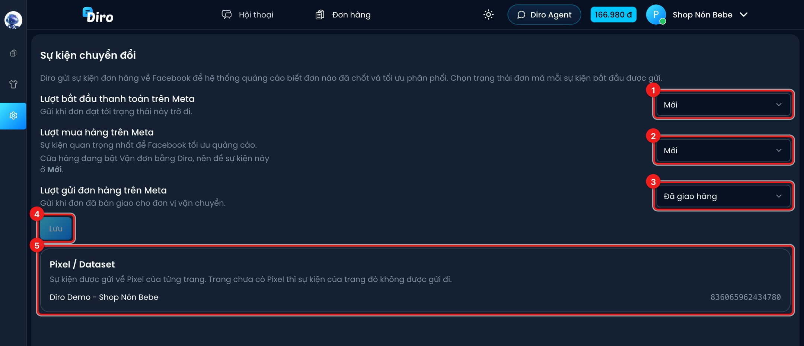

# Sự kiện chuyển đổi Facebook

Diro gửi sự kiện đơn hàng về Facebook (Conversions API) để hệ thống quảng cáo biết khách nào đã
chốt đơn. Nhờ vậy Facebook tối ưu quảng cáo theo người mua thật, không chỉ theo người nhắn tin.
Bạn chọn đơn tới trạng thái nào thì mỗi sự kiện được gửi.

## Mở trang thiết lập

Vào **Thiết lập → Cửa hàng → Sự kiện chuyển đổi**.

1. **Lượt bắt đầu thanh toán trên Meta** (InitiateCheckout): gửi khi đơn đạt tới trạng thái đã
   chọn trở đi. Mặc định **Mới**, tức là gửi ngay khi có đơn.
2. **Lượt mua hàng trên Meta** (Purchase): sự kiện quan trọng nhất để Facebook tối ưu quảng cáo.
   Mặc định **Đã xác nhận**.
3. **Lượt gửi đơn hàng trên Meta** (OrderShipped): báo đơn đã bàn giao cho hãng vận chuyển.
   Mặc định **Đang vận chuyển**.
4. Bấm **Lưu** sau khi đổi. Nút chỉ sáng lên khi bạn có thay đổi.
5. **Pixel / Dataset**: Pixel của từng trang. Trang hiện **Chưa có Pixel** thì sự kiện của trang
   đó **không được gửi**.

Mỗi ô cho chọn một trong các trạng thái: **Mới**, **Chờ hàng**, **Đã xác nhận**, **Đang đóng
hàng**, **Chờ lấy hàng**, **Đang vận chuyển**, **Đã giao hàng**, **Đã thu tiền**.

## Cách gửi hoạt động

- "Từ trạng thái này trở đi": nếu bạn chọn **Đã xác nhận**, đơn chuyển thẳng từ Mới sang Đang
  vận chuyển vẫn được gửi Lượt mua hàng.
- Mỗi sự kiện chỉ gửi **một lần** cho mỗi đơn, dù trạng thái đổi qua lại nhiều lần.
- Chỉ đơn gắn với **khách nhắn tin trên Messenger** mới được gửi. Đơn tạo tay không gắn hội
  thoại, hay đơn từ TikTok Shop, không có sự kiện.
- Giá trị gửi đi là **tổng tiền đơn**, kèm danh sách mã sản phẩm và số lượng.
- Đơn "Tạo lại đơn (sửa lỗi)" không gửi lại sự kiện mà đơn gốc đã gửi.

Nếu bạn chọn Lượt mua hàng ở trạng thái **sớm hơn** Lượt bắt đầu thanh toán, trang hiện cảnh
báo đỏ. Vẫn lưu được, nhưng Facebook có thể nhận sự kiện mua hàng trước sự kiện bắt đầu thanh toán.

## Nên chọn mốc nào

- Chọn Lượt mua hàng **sớm** (Mới, Đã xác nhận): Facebook nhận tín hiệu nhanh, nhiều, nhưng có cả
  đơn sau này bị huỷ hoặc hoàn.
- Chọn **muộn** (Đã giao hàng): tín hiệu sạch hơn nhưng ít và chậm vài ngày, quảng cáo học chậm hơn.

:::info Đang bật "Vận đơn bằng Diro"?
Nếu tài khoản bật **Vận đơn bằng Diro** (trong trang Tài khoản), dưới mục Lượt mua hàng có dòng
nhắc nên để ở **Mới**. Lý do: với chế độ này, đơn có thể không đi qua các trạng thái trung gian
theo cách thông thường.
:::

## Trang thuộc shop

Nếu trang của bạn nằm trong một **shop** gộp nhiều trang, thiết lập được làm ở cấp shop. Trang
con sẽ hiện dòng **Sự kiện chuyển đổi được cấu hình tại cửa hàng …** kèm link **Mở thiết lập của
cửa hàng**, các ô chọn bị khoá.

:::tip
Số liệu trên Ads Manager thường lệch với số đơn trên Diro, vì Facebook chỉ ghi nhận đơn của
người đã bấm quảng cáo trong khung thời gian tính chuyển đổi. Đây là cách Facebook quy gán,
không phải Diro gửi thiếu.
:::
