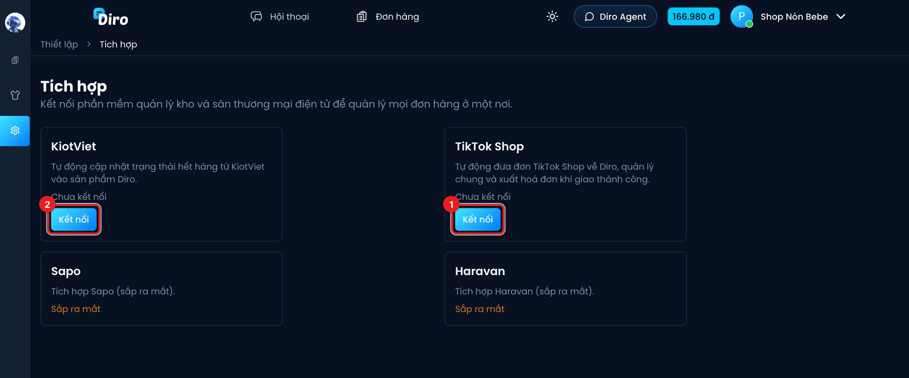
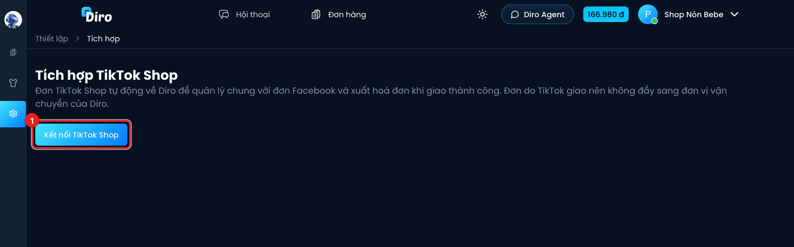

# TikTok Shop

Kết nối TikTok Shop để đơn trên TikTok tự động về Diro. Bạn quản lý chung với đơn Facebook,
theo dõi trạng thái giao hàng, và xuất hoá đơn điện tử khi đơn giao thành công (nếu
đã thiết lập ở mục Hoá đơn điện tử).

## Kết nối

Vào **Thiết lập → Tồn kho & sàn TMĐT**.

1. Ở thẻ **TikTok Shop**, bấm **Kết nối**.
2. (Thẻ **KiotViet**, xem trang [KiotViet](./kiotviet.md).)

1. Bấm **Kết nối TikTok Shop**. Diro chuyển bạn sang trang của TikTok để đăng nhập tài khoản
   người bán và cấp quyền cho Diro.

Cấp quyền xong, TikTok đưa bạn quay về Diro với thông báo **Kết nối thành công. Diro đang kéo
đơn 30 ngày gần nhất về.**

Muốn nối thêm shop TikTok khác vào cùng trang, bấm **Kết nối thêm shop**.

## Sau khi kết nối

Mỗi shop đã kết nối hiện thành một thẻ gồm: tên shop, **Người bán**, **Mã shop**, **Đồng bộ lần
cuối**, và trạng thái **Hoạt động** hoặc **Đã ngắt**.

- **Đồng bộ ngay**: kéo đơn mới về ngay, không cần chờ.
- **Ngắt kết nối**: đơn mới trên TikTok sẽ không về Diro nữa. Đơn đã về vẫn giữ nguyên.
- **Kết nối lại**: hiện khi kết nối bị ngắt (ví dụ quyền TikTok hết hạn). Dòng **Lý do** cho
  biết vì sao.

Diro nhận đơn ngay khi TikTok báo có thay đổi, và tự quét lại **mỗi 10 phút** để không sót đơn.

## Đơn TikTok trên Diro

- Đơn chỉ về khi đã qua bước thanh toán (đơn COD về ngay). Đơn chưa thanh toán không được tạo
  để tránh đơn rác.
- Tên khách, SĐT, địa chỉ lấy từ đơn TikTok. Ghi chú đơn có dòng **TikTok Shop #mã đơn**, kèm lời
  nhắn của khách nếu có.
- **Khớp sản phẩm**: nếu **SKU người bán** trên TikTok trùng **mã biến thể** hoặc **mã sản phẩm**
  trên Diro (cùng trang), dòng hàng được gắn với sản phẩm đó. Không trùng thì vẫn tạo dòng hàng
  theo tên sản phẩm TikTok. Hãy đặt mã cho khớp để thống kê và hoá đơn được chính xác.
- Giảm giá, voucher của sàn được gộp vào **giảm giá đơn**, để tổng tiền trên Diro đúng bằng số
  khách trả trên TikTok.

Trạng thái đơn tự đổi theo TikTok:

| TikTok | Diro |
|---|---|
| Đang giữ đơn (On hold) | Mới |
| Chờ gửi hàng | Đã xác nhận |
| Gửi một phần | Đang đóng hàng |
| Chờ lấy hàng | Chờ lấy hàng |
| Đang vận chuyển | Đang vận chuyển |
| Đã giao | Đã giao hàng |
| Hoàn tất (hết hạn đổi trả, TikTok đã quyết toán) | Đã thu tiền |
| Đã huỷ | Đã hủy |

:::caution
- Đơn TikTok do TikTok giao, nên **không gửi sang đơn vị vận chuyển của Diro** được.
- Đơn về Diro khi **đã giao xong** (thường là các đơn cũ trong 30 ngày kéo về lúc mới kết nối)
  sẽ **không** tự xuất hoá đơn. Đơn còn đang đi thì xuất bình thường khi giao thành công.
:::
