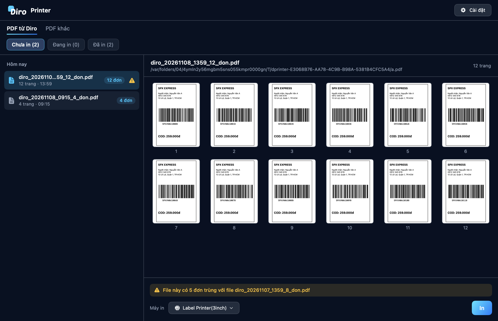
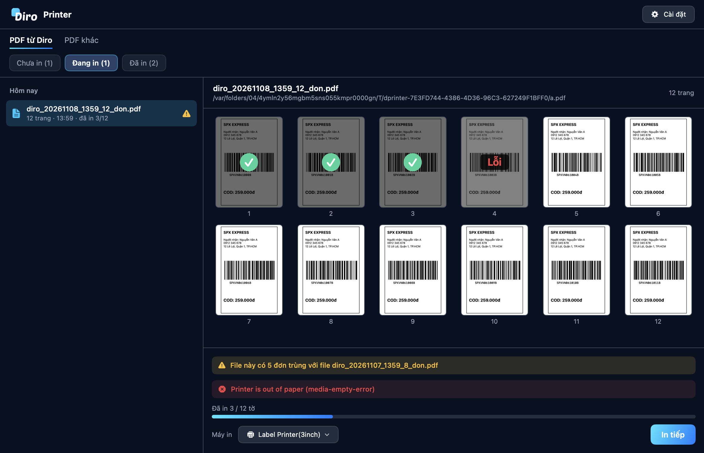
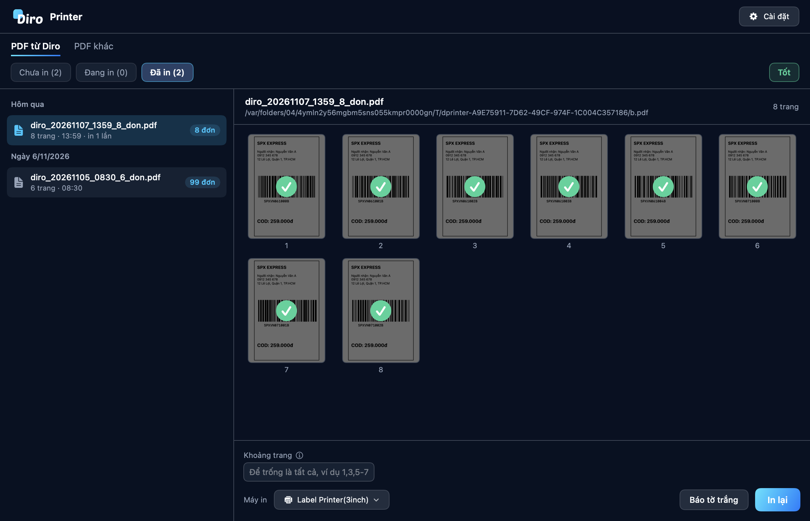
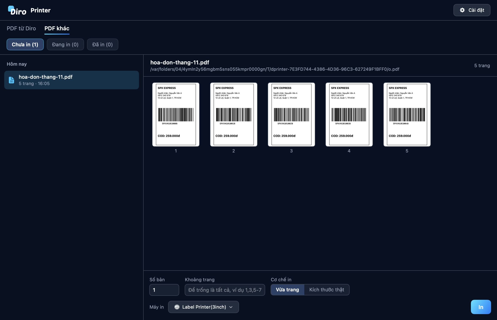
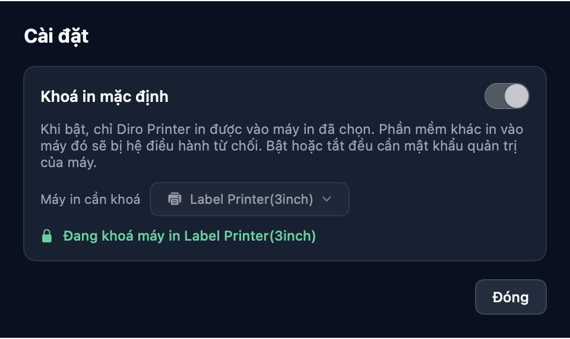

# 🖨️ Diro Printer

**Diro Printer** là phần mềm cài trên máy tính, giúp bạn **không in trùng tem**.
Phần mềm nhớ từng file PDF đã in tới từng trang, nên bạn luôn biết file nào chưa
in, file nào đang in dở và file nào đã in xong.

Bạn vẫn xuất PDF từ Diro như bình thường. Diro Printer tự tìm các file PDF trong
ba thư mục **Downloads**, **Desktop** và **Documents**, bạn chỉ cần chọn file và
bấm **In**. Phần mềm không cần đăng nhập.



:::tip Điều đặc biệt nhất

**Hết giấy giữa chừng không còn là chuyện đoán mò.** Phần mềm in từng trang và
đánh dấu từng trang. Thay giấy xong bấm **In tiếp**, phần mềm in từ đúng trang
đang dở, không in lại những trang đã xong.
:::

---

## 📥 Bước 1: Tải phần mềm về máy

| Máy của bạn | Bấm để tải | Sau khi tải xong |
|---|---|---|
| **Windows 10 / 11** | **[⬇️ TẢI CHO WINDOWS](https://github.com/nhatduy129/diro-printer/releases/download/v1.3.2/DiroPrinter-1.3.2-win-x64.zip)**<br />`DiroPrinter-1.3.2-win-x64.zip` · ≈64 MB | **Giải nén** rồi bấm đúp `DiroPrinter.exe`, **không cần cài đặt** |
| **macOS 14 trở lên**<br />(cả Apple Silicon và Intel) | **[⬇️ TẢI CHO macOS](https://github.com/nhatduy129/diro-printer/releases/download/v1.3.2/DiroPrinter-1.3.2-macos.zip)**<br />`DiroPrinter-1.3.2-macos.zip` · ≈2,2 MB | **Giải nén** rồi kéo `Diro Printer.app` vào thư mục **Applications** |

Số `1.3.2` trong tên file là **phiên bản**. Xem các bản phát hành khác tại
[trang Releases](https://github.com/nhatduy129/diro-printer/releases).

:::tip Link chính báo lỗi hoặc tải không được?
Hãy tải từ link dự phòng của Diro:
**[⬇️ Windows (dự phòng)](https://diro.sgp1.digitaloceanspaces.com/public-downloads/diro-printer/v1.3.2/DiroPrinter-1.3.2-win-x64.zip)** ·
**[⬇️ macOS (dự phòng)](https://diro.sgp1.digitaloceanspaces.com/public-downloads/diro-printer/v1.3.2/DiroPrinter-1.3.2-macos.zip)**
:::

:::note Cách giải nén
**Windows**: bấm chuột phải vào file `.zip` → **Extract All…** → **Extract**.
Nhớ giải nén ra rồi mới chạy, chạy thẳng từ trong file nén sẽ lỗi.

**macOS**: bấm đúp vào file `.zip` là tự giải nén.
:::

:::warning Lần đầu mở máy có thể cảnh báo, đây là bình thường

Phần mềm chưa mua chứng chỉ ký số nên hệ điều hành chưa "quen mặt":

**Trên Windows**, hiện bảng xanh *"Windows protected your PC"*:
🔹 Bấm **More info** → 🔹 Bấm **Run anyway**

**Trên macOS**, báo *"không mở được vì chưa xác minh nhà phát triển"*:

*Từ macOS 15 (Sequoia) trở lên*:
🔹 Bấm đúp vào app một lần (sẽ hiện cảnh báo, cứ bấm **Done**) →
🔹 Vào  **> System Settings > Privacy & Security** →
🔹 Kéo xuống cuối, chỗ nhắc tên *Diro Printer*, bấm **Open Anyway** →
🔹 Xác nhận bằng vân tay hoặc mật khẩu máy

*macOS 14*: bấm **chuột phải** vào app → chọn **Open** → bấm **Open** lần nữa.

Chỉ phải làm một lần duy nhất. Các lần sau mở bình thường.

Vẫn không mở được, hoặc báo app *"bị hỏng"*? Mở **Terminal**, dán dòng này rồi
Enter, sau đó mở app lại:

```bash
xattr -dr com.apple.quarantine "/Applications/Diro Printer.app"
```
:::

:::caution Trên macOS, hãy bấm Allow khi được hỏi quyền thư mục
Lần đầu mở, macOS hỏi phần mềm có được đọc Downloads, Desktop, Documents hay
không. Hãy bấm **Allow** cả ba. Nếu bấm từ chối, phần mềm hiện dải cảnh báo ghi
tên thư mục chưa được cấp quyền.
:::

---

## 📂 Bước 2: Hiểu các danh sách

Phần mềm chia file thành hai nhóm:

- **PDF từ Diro**: file tem xuất từ Diro
- **PDF khác**: mọi file PDF còn lại

Mỗi nhóm có ba mục, kèm số file trong ngoặc: **Chưa in**, **Đang in** và
**Đã in**. File được xếp theo ngày, mới nhất ở trên: *Hôm nay*, *Hôm qua*,
*Ngày 6/11/2026*.

Mỗi file tem có nhãn số đơn, ví dụ **99 đơn**, ngay trên dòng của file.

:::info Lần đầu mở phần mềm
Mọi file PDF đang có sẵn trên máy sẽ được xếp vào **Đã in**, để danh sách không
bị đầy file cũ. Từ lúc đó, file PDF mới sẽ vào **Chưa in**.
:::

---

## 🖨️ Bước 3: In

🔹 Chọn file trong danh sách, xem trước các trang ở bên phải
🔹 Chọn **Máy in**
🔹 Bấm **In**

File chuyển ngay sang **Đang in**, có thanh tiến độ, và khung xem trước tự cuộn
theo trang đang in.

| Trang trong khung xem trước | Ý nghĩa |
|---|---|
| Bình thường | Chưa in |
| Tối đi, có dấu tick xanh | Đã in xong |
| Mờ đi, có chữ **Lỗi** màu đỏ | In trang này bị lỗi |

### Khi máy in báo lỗi



Phần mềm dừng lại và hiện **nguyên văn thông báo của máy in**, thường là tiếng
Anh (ví dụ hết giấy là *out of paper*). Xử lý xong, ví dụ thay giấy, bấm
**In tiếp** để in từ đúng trang đang dở.

Nếu sau 30 giây máy in vẫn chưa in xong trang đó, phần mềm báo **Máy in không
phản hồi, kiểm tra giấy và dây cáp**.

:::caution Kiểm tra tờ tem ở trang báo lỗi
Khi có lỗi, máy in có thể đã ra được một phần tờ đó, nên hãy nhìn lại tờ cuối
trước khi bấm **In tiếp**. Đóng phần mềm khi đang in cũng được xử lý như lỗi ở
đúng trang đó.
:::

---

## ⚠️ Cảnh báo đơn trùng

Với file xuất từ Diro, phần mềm so mã vận đơn giữa các file. File nào có đơn đã
in ở file khác sẽ có **chấm than vàng** trên dòng file. Rê chuột vào chấm than,
hoặc nhìn dải vàng phía trên nút In, sẽ thấy ví dụ:

> File này có 2 đơn trùng với file diro_20261107_1359_8_don.pdf

Đây chỉ là **cảnh báo**: nếu bấm In, phần mềm vẫn in cả file. Nếu không muốn in
trùng, hãy quay lại Diro và xuất lại file không có các đơn đó.

:::note Chỉ áp dụng cho file xuất từ bản Diro mới
Mã vận đơn được ghi vào file PDF từ Diro web bản 1.25.0. File xuất trước đó vẫn
nằm trong **PDF từ Diro** nhờ tên file, nhưng không so trùng được.
:::

---

## 📊 Nhãn in trùng trong 24 giờ

Bên phải hàng **Chưa in**, **Đang in**, **Đã in** có một nhãn cho biết máy này đã in trùng tem nào trong 24 giờ qua:

| Nhãn | Ý nghĩa |
|---|---|
| **Tốt** (xanh) | Không có tem đơn nào in bị trùng |
| **Có X đơn in bị trùng** (vàng) | Từ 1 đến 4 đơn có tem được in từ 2 lần trở lên |
| **Có X đơn in bị trùng** (đỏ) | Từ 5 đơn trở lên |

Rê chuột vào nhãn để xem mã vận đơn và số lần in. In lại có chủ đích cũng được tính.

:::note Mỗi máy đếm riêng
Nhãn chỉ tính những lần in trên chính máy đó. Hai máy khác nhau không thấy số của nhau.
:::

---

## ✅ Đơn tự chuyển sang Đã in

Trên Diro, vào **Thiết lập → Mẫu in & thiết lập Diro Printer**, tab **Thiết lập Diro Printer**, bật **In đơn (file PDF) thông qua Diro Printer**.

Thiết lập này áp dụng cho **toàn bộ tài khoản** của bạn, gồm mọi trang và cửa hàng. Nhân viên và tài khoản đã liên kết theo thiết lập của chủ tài khoản.

Từ lúc đó, đơn đã xuất PDF sẽ ở trạng thái **Chờ in**. In xong tờ tem vận đơn bằng Diro Printer, đơn tự chuyển sang **Đã in**. Máy mất mạng vẫn in bình thường, có mạng lại phần mềm tự báo tiếp.

:::warning Cài Diro Printer 1.2.0 trước khi bật
Bản cũ hơn không báo trạng thái về Diro. Đơn in bằng phần mềm khác sẽ ở Chờ in cho tới khi hãng vận chuyển lấy hàng.
:::

---

## ✔️ File đã in bằng cách khác

Nếu đã in file bằng phần mềm khác, hãy **nhấp phải** vào file trong mục **Chưa in**, chọn **Đánh dấu đã in** rồi bấm **Xác nhận**. File chuyển sang **Đã in** và được ghi là *In ngoài Diro Printer*. Các đơn Chờ in trong file sẽ chuyển sang Đã in trên Diro.

---

## 🔁 In tiếp và in lại



Tuỳ chọn hiện ra theo từng loại file:

| Loại file | Chưa in, Đang in | Đã in |
|---|---|---|
| **PDF từ Diro** | Không có tuỳ chọn, luôn in vừa trang | Chỉ có **Khoảng trang** |
| **PDF khác** | **Số bản**, **Khoảng trang**, **Cơ chế in** | **Số bản**, **Khoảng trang**, **Cơ chế in** |

**Khoảng trang** để trống là in tất cả. Có thể gõ `5`, `2-5`, hoặc `1,3,5-7`. Rê
chuột vào biểu tượng ⓘ cạnh ô để xem giải thích ngay trong phần mềm.

**In lại** chỉ đặt lại những trang bạn chọn. Các trang khác giữ nguyên trạng
thái đã in.



**Cơ chế in** gồm **Vừa trang** (co giãn cho vừa khổ giấy) và **Kích thước
thật** (giữ đúng kích thước trong file).

---

## 🔒 Khoá in mặc định (không bắt buộc)

Bấm **Cài đặt** ở góc trên bên phải. Mục **Khoá in mặc định** **tắt sẵn**.



Khi bật, **chỉ Diro Printer in được vào máy in đã chọn**. Phần mềm khác in vào
máy đó sẽ bị hệ điều hành từ chối, và các máy in khác không bị ảnh hưởng. Bật
hoặc tắt đều cần mật khẩu quản trị của máy.

:::warning Khoá áp dụng cho mọi phần mềm khác
Chrome, Word, trình xem PDF hay Google Slides đều không in được vào máy đang
khoá. Muốn in từ Google Slides, hãy tải bản PDF về rồi in trong mục
**PDF khác**, hoặc tắt khoá trong Cài đặt.

Người có quyền quản trị máy vẫn có thể tắt khoá hoặc cắm máy in sang máy khác.
Khoá giúp tránh in nhầm, chứ không ngăn được người cố tình.
:::

---

## 📋 Gửi nhật ký cho Diro khi in gặp sự cố

Phần mềm ghi lại mọi lần in trên máy bạn: in file nào, vào máy in nào, từng trang
xong hay lỗi, và nguyên văn lỗi của máy in. Nhật ký được giữ 90 ngày.

🔹 Bấm **Cài đặt** ở góc trên bên phải
🔹 Trong mục **Nhật ký**, bấm **Xuất nhật ký**
🔹 Phần mềm tạo file `DiroPrinter-nhatky-….zip` ở **Desktop** và mở sẵn thư mục
🔹 Gửi file đó cho đội Diro qua Zalo 0333 263 400

:::note Trong file nhật ký có gì
Có tên file, đường dẫn trên máy, mã vận đơn và trạng thái in của từng trang. Không
có bản sao file PDF, nên không có tên, số điện thoại hay địa chỉ người nhận.
:::

---

## ⬆️ Nâng cấp phần mềm

Từ bản 1.2.0, khi có phiên bản mới phần mềm sẽ hỏi **Bỏ qua** hay **Nâng cấp**. Bấm **Nâng cấp** là phần mềm tự tải, tự thay bản mới rồi mở lại, lịch sử in vẫn giữ nguyên. Bấm **Bỏ qua** thì lần mở sau sẽ hỏi lại.

Đang in thì chưa nâng cấp được, hãy chờ in xong. Trên Windows, nếu báo không ghi được vào thư mục, hãy chuyển `DiroPrinter.exe` ra Desktop rồi thử lại.

---

## ❓ Gặp trục trặc

**Không thấy file vừa xuất từ Diro**
Phần mềm chỉ tìm trong Downloads, Desktop và Documents. Nếu trình duyệt lưu ở
thư mục khác, hãy chuyển file vào một trong ba thư mục đó. Trên macOS, kiểm tra
thêm quyền thư mục ở phần trên.

**Không thấy máy in vừa cắm**
Bản Windows chỉ đọc danh sách máy in lúc mở phần mềm, hãy tắt phần mềm rồi mở lại.

**Máy in ra tờ tem trắng**
Bấm **Báo tờ trắng** ngay khi thấy, phần mềm sẽ ghi lại thời điểm và trang đó. Sau đó [xuất nhật ký](#-gửi-nhật-ký-cho-diro-khi-in-gặp-sự-cố) gửi cho đội Diro. Thường gặp do cảm biến khe hở của máy in, hãy thử hiệu chỉnh (calibrate) và lau cảm biến.

**Tem bị lệch hoặc sai khổ**
Kiểm tra khổ giấy trong phần cài đặt máy in của Windows hoặc macOS. Với PDF khác,
thử đổi **Cơ chế in**.

**Nút In bị mờ**
Kiểm tra đã chọn máy in chưa, ô **Khoảng trang** có báo lỗi không, và phần mềm có
đang in file khác không. Mỗi lúc chỉ in một file.

---

## 📌 Cần chuẩn bị những gì

- Máy **Windows 10/11** hoặc **macOS 14** trở lên
- Máy in đã cài driver và in được bình thường trên máy đó
- Không cần tài khoản hay API key
