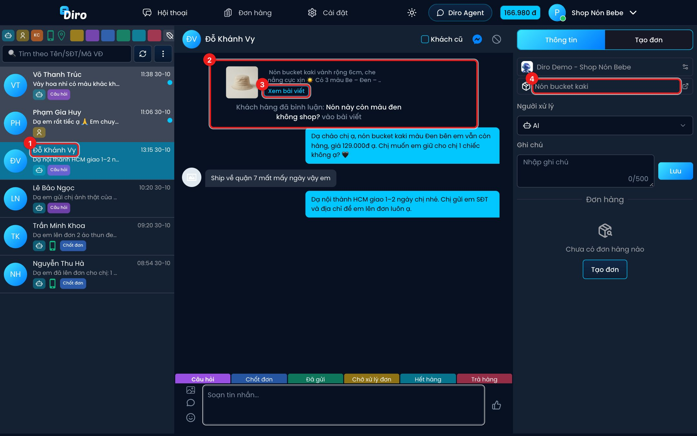

# Bình luận

Khi khách bình luận vào bài viết của Fanpage, bình luận đó được đưa vào **hội thoại của chính khách
đó** trong màn hình Hội thoại — bạn không cần mở một màn hình riêng.

1. Người bình luận có một dòng hội thoại trong danh sách, như mọi khách nhắn tin.
2. Bình luận hiện trong khung chat dạng **Khách hàng đã bình luận: "…" vào bài viết**, kèm ảnh và
   đoạn đầu của bài viết.
3. Bấm **Xem bài viết** để mở bài gốc trên Facebook.
4. Nếu bài viết đã gắn với một sản phẩm (xem mục Chat Agent → Danh sách sản phẩm, tab Bài viết),
   sản phẩm đó hiện ở cột **Thông tin** để AI và nhân viên biết khách đang hỏi món nào.

Tin AI nhắn riêng cho người bình luận nằm ngay bên dưới, như một cuộc trò chuyện Messenger bình thường.

- Khách **mới chỉ bình luận**, chưa nhắn tin lần nào, vẫn có một dòng hội thoại trong danh sách.
  Khi khách nhắn tin, hội thoại này tự gộp vào hội thoại Messenger của khách.
- Bình luận được tính là tin của khách: hội thoại có bình luận mới cũng nhảy lên đầu danh sách và
  có chấm "chưa xem".
- Nếu AI ẩn một bình luận tiêu cực, khung chat có dòng thông báo đã ẩn bình luận.

## Cho AI tự xử lý bình luận

Hai tuỳ chọn sau nằm trong thiết lập **Chat Agent** của trang (mục AI Agent):

- **Tự động nhắn tin cho khách hàng bình luận vào bài viết** — AI nhắn riêng cho người bình luận và
  trả lời dưới bình luận để báo khách kiểm tra tin nhắn.
- **Tự động ẩn bình luận tiêu cực vào bài viết** — AI ẩn bình luận chê bai, phàn nàn giá, thô tục,
  quảng cáo sản phẩm khác hoặc có số điện thoại (để tránh lộ thông tin khách).

:::note
Nếu AI không nhắn riêng được cho người bình luận, thường là do Facebook không cho phép trả lời
riêng bình luận đó (ví dụ bình luận đã quá cũ hoặc người dùng đã nhận tin trả lời riêng trước đó).
:::
