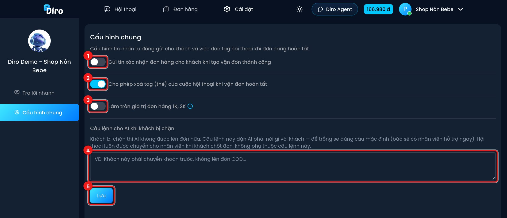

# Cấu hình chung

Trang **Cấu hình chung** chứa vài tuỳ chọn về tin nhắn tự động và thẻ hội thoại của **một trang**.
Mở bằng **Cài đặt** trên thanh trên cùng màn hình Hội thoại, rồi chọn **Cấu hình chung** ở cột trái.

1. **Gửi tin xác nhận đơn hàng cho khách khi tạo vận đơn thành công** — bật thì mỗi khi đơn được
   gửi sang hãng vận chuyển thành công, Diro tự nhắn khách một tin xác nhận đơn.
2. **Cho phép xoá tag (thẻ) của cuộc hội thoại khi vận đơn hoàn tất** — bật (mặc định) thì khi đơn
   giao thành công hoặc hoàn xong, mọi thẻ của hội thoại được gỡ (trừ khi khách còn đơn khác đang
   chạy). Xem [Thẻ hội thoại](./the-hoi-thoai.md).
3. **Làm tròn giá trị đơn hàng 1K, 2K** — làm tròn **lên** tiền thu hộ (COD). Ví dụ 99k thành 100k,
   188k thành 190k.
4. **Câu lệnh cho AI khi khách bị chặn** — dặn AI nói gì với khách đã bị chặn, ví dụ "Khách này phải
   chuyển khoản trước, không lên đơn COD". Để trống thì AI dùng câu mặc định (báo sẽ có nhân viên hỗ
   trợ ngay). Dù có câu lệnh hay không, hội thoại của khách bị chặn luôn được chuyển cho nhân viên khi
   khách chốt đơn. Xem [Khách cũ và chặn khách](./khach-cu-va-chan-khach.md).
5. Bấm **Lưu** để áp dụng. Các công tắc ở trang này **chỉ có hiệu lực sau khi bấm Lưu**.
