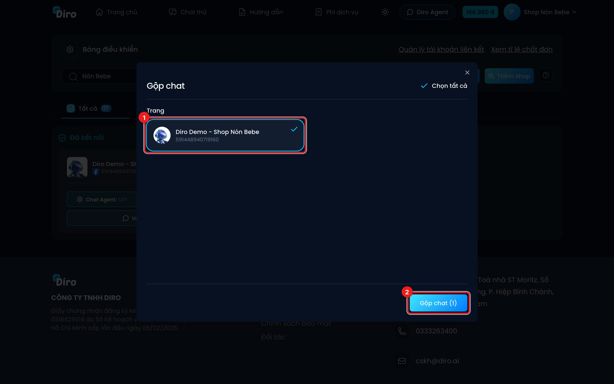
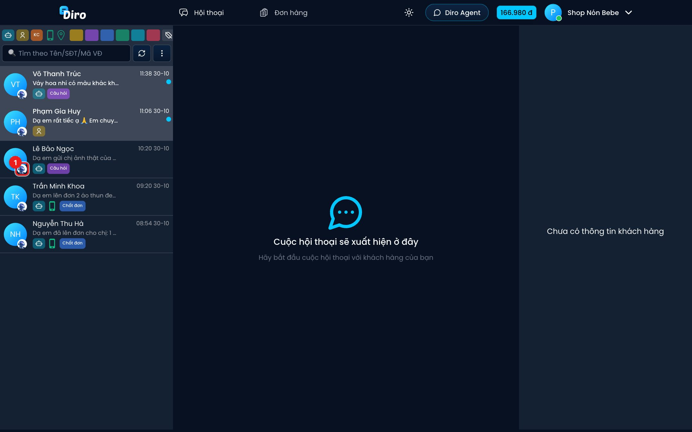
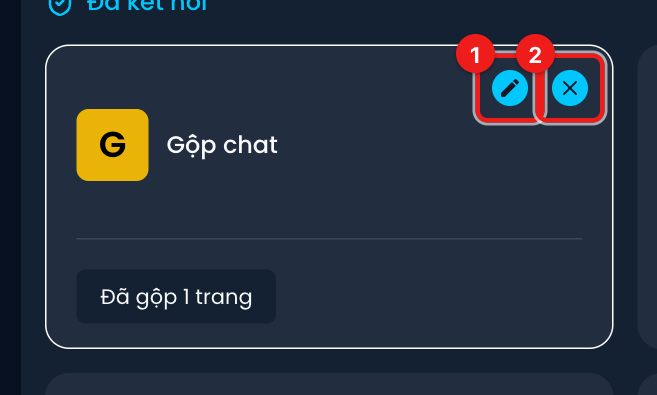

# Gộp chat nhiều trang

Nếu bạn có nhiều Fanpage, **Gộp chat** cho phép xem tin nhắn của nhiều trang (hoặc nhiều shop) trong
**một danh sách hội thoại** — nhân viên không phải nhảy qua lại từng trang.

:::info Gộp chat khác Thêm shop
**Gộp chat** chỉ gộp **khung nhìn**: sản phẩm, kho, đơn hàng, mã đơn của từng trang giữ nguyên.
**Thêm shop** thì gộp thật ở tầng dữ liệu — các trang dùng chung sản phẩm, kho và đơn hàng. Xem
mục Shop, nhân viên & tài khoản liên kết.
:::

## Tạo gộp chat

1. Vào **Bảng điều khiển**, bấm nút **Gộp chat** (cạnh nút Thêm trang).
2. Tick các **shop** và/hoặc **trang** muốn xem chung, rồi bấm **Gộp chat (số mục)**.

- Tick một **shop** là lấy hết chat của các trang trong shop đó; các trang con của shop bị khoá
  lại (hiện "Đã trong shop") vì đã theo shop vào danh sách.
- Danh sách trang lẻ chỉ gồm các trang còn kết nối.
- Có ô **Chọn tất cả** ở góc trên.

Bấm xong, Diro chuyển bạn sang màn hình chat gộp.

## Màn hình chat gộp

Màn hình giống hệt chat của một trang, chỉ khác:

1. Mỗi hội thoại có **ảnh đại diện nhỏ của trang** ở góc avatar khách, để biết khách nhắn vào trang nào.

- Mọi bộ lọc, tìm kiếm, **Đánh dấu đã xem tất cả**, **Cho AI nhắn hội thoại chưa phản hồi** đều
  áp dụng cho tất cả trang đang gộp.
- Thanh trên cùng không có mục **Cài đặt** (cài đặt chat làm theo từng trang).

## Sửa hoặc bỏ gộp

Sau khi gộp, Bảng điều khiển có thêm thẻ **Gộp chat** ghi "Đã gộp N trang". Bấm vào thẻ để mở lại
màn hình chat gộp. Rê chuột lên thẻ để hiện 2 nút:

1. **Cập nhật** (bút chì) — thêm / bớt trang.
2. **Xoá** (dấu ×) — bỏ gộp. Bỏ gộp **không xoá** trang hay dữ liệu nào.

## Cần nhớ

- Lựa chọn gộp được lưu **tại trình duyệt đang dùng**. Đăng nhập máy khác hoặc xoá dữ liệu trình
  duyệt thì phải gộp lại.
- Shop có thêm trang mới thì chat gộp tự nhận trang đó; nếu chưa thấy, mở **Cập nhật** rồi lưu lại.
- Gộp càng nhiều trang thì danh sách tải càng lâu — chỉ gộp những trang cần xem cùng lúc.
- Nhân viên cũng dùng được Gộp chat với những trang được cấp quyền. Kỹ thuật viên thì không (họ không xem chat).
