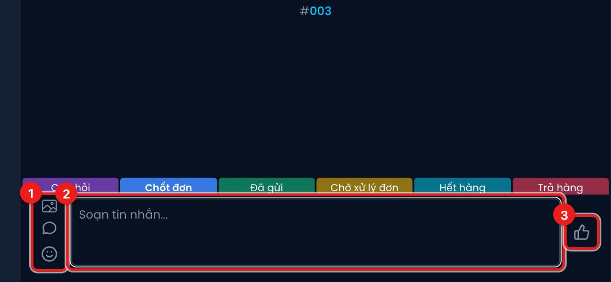
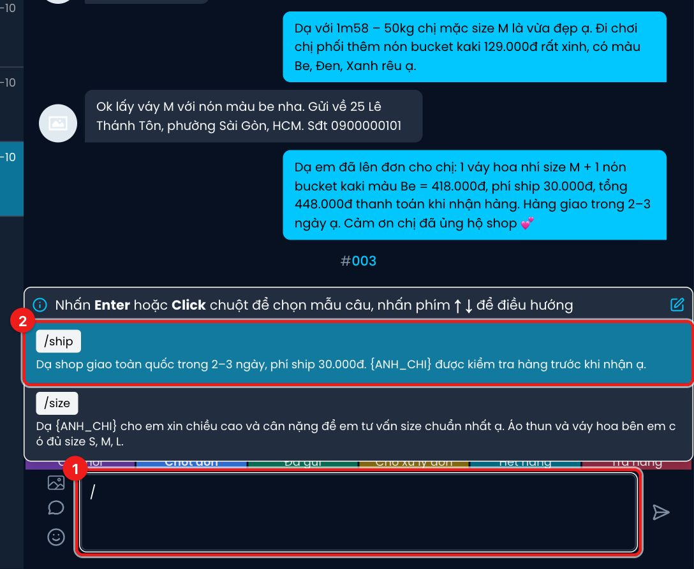

# Gửi tin nhắn cho khách

Bạn có thể nhắn thẳng cho khách từ Diro, khách nhận được như tin nhắn của Fanpage trên Messenger.

1. Ba nút bên trái, từ trên xuống:
   - **Thêm ảnh hoặc video** — chọn ảnh/video từ máy (JPG, PNG, GIF, WEBP, HEIC, AVIF…), chọn được nhiều cái.
   - **Trả lời nhanh** — mở danh sách mẫu trả lời nhanh.
   - **Thêm biểu tượng** — chèn emoji.
2. **Ô soạn tin**. Nhấn **Enter** để gửi, **Shift + Enter** để xuống dòng. Bạn cũng có thể dán ảnh
   (Ctrl/Cmd + V) hoặc kéo thả ảnh vào ô này.
3. Khi ô trống, nút bên phải là **👍** — bấm để gửi một dấu like. Khi có chữ hoặc ảnh, nút đổi
   thành **mũi tên gửi**.

:::caution Tin nhắn gửi đi là thật
Nhấn Enter là tin được gửi ngay tới khách, không có bước xác nhận. Kiểm tra kỹ trước khi gửi.
:::

:::note
Nhắn tay cho khách **không** chuyển hẳn hội thoại sang Nhân viên. Tuỳ thiết lập của Chat Agent, AI
có thể chỉ tạm nhường vài phút rồi lại trả lời tiếp. Muốn AI dừng hẳn với khách này, hãy chuyển
**Người xử lý** sang **Nhân viên** ở cột bên phải (xem
[Người xử lý, ghi chú và đơn hàng](./thong-tin-khach-hang.md)).
:::

## Chèn mẫu trả lời nhanh bằng dấu `/`

1. Gõ **`/`** vào ô soạn tin (hoặc `/` + ký tự tắt, ví dụ `/ship`).
2. Danh sách mẫu hiện ra. Dùng phím **↑ ↓** để chọn, nhấn **Enter** hoặc bấm chuột để chèn.

Mẫu **tin nhắn thường** được đổ vào ô soạn để bạn đọc lại, sửa rồi mới gửi. Các chỗ như `{ANH_CHI}`
được thay sẵn bằng "anh"/"chị"/"bạn", số điện thoại, địa chỉ… của khách. Nếu hội thoại thiếu dữ liệu
mà mẫu cần (ví dụ mẫu có `{SDT_KHACH_HANG}` nhưng khách chưa cho số), Diro báo lỗi và không chèn.

Mẫu có nhãn **Tiện ích** là **tin nhắn tiện ích**: chọn là **gửi đi ngay**, không qua ô soạn. Mẫu
có nhãn **Chưa duyệt** thì chưa được Facebook duyệt nên chưa dùng được.

Cách tạo mẫu: xem [Trả lời nhanh](./tra-loi-nhanh.md).

## Tin gửi không thành công

Tin nào gửi không được sẽ có chữ đỏ **Không gửi được** bên dưới. Nguyên nhân thường gặp: quá 24 giờ
kể từ tin cuối của khách (giới hạn của Facebook — khi đó chỉ gửi được tin tiện ích), khách đã chặn
trang, hoặc trang mất kết nối.
