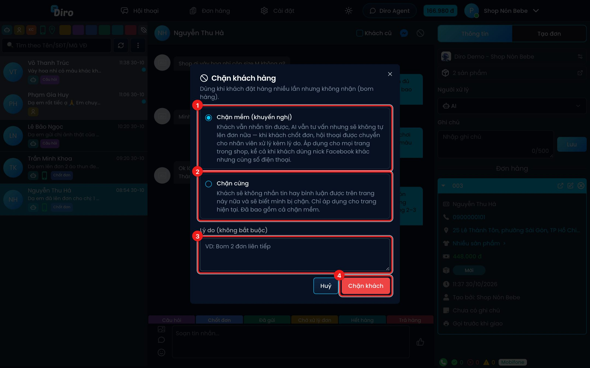

# Khách cũ và chặn khách

## Khách cũ (KC)

Nhãn **KC** trên dòng hội thoại giúp bạn nhận ra ngay khách đã từng mua:

- **KC xanh** — khách từng nhận hàng thành công.
- **KC đỏ** — khách từng trả hàng (bom hàng).
- **KC cam** — khách vừa từng nhận, vừa từng trả hàng.

Diro **tự gắn** các nhãn này khi đơn của khách giao thành công hoặc bị hoàn. Nếu khách từng mua
trước khi bạn dùng Diro, bạn đánh dấu tay bằng ô **Khách cũ** trên thanh tên khách (xem ảnh ở
[Màn hình hội thoại](./man-hinh-hoi-thoai.md)). Tick vào là **lưu ngay**.

Dùng nút **KC** trên hàng lọc để chỉ xem, hoặc loại bỏ, khách cũ (xem
[Tìm kiếm và lọc hội thoại](./tim-kiem-va-loc.md)).

## Chặn khách hay bom hàng

Khi một khách đặt nhiều lần mà không nhận hàng, bạn chặn khách để AI không lên đơn cho họ nữa.

1. Mở hội thoại của khách, bấm biểu tượng **⃠** (Chặn khách hàng) trên thanh tên khách.
2. Chọn mức chặn rồi bấm **Chặn khách**.

1. **Chặn mềm (khuyến nghị)** — khách vẫn nhắn tin được, AI vẫn tư vấn nhưng **không tự lên đơn**.
   Khi khách chốt, hội thoại được chuyển cho nhân viên kèm lý do. Áp dụng cho **mọi trang trong
   shop**, kể cả khi khách dùng nick Facebook khác nhưng cùng số điện thoại.
2. **Chặn cứng** — khách **không nhắn tin hay bình luận được** trên trang này nữa và sẽ biết mình bị
   chặn. Chỉ áp dụng cho trang hiện tại, đã bao gồm chặn mềm.
3. **Lý do** (không bắt buộc), ví dụ "Bom 2 đơn liên tiếp".
4. Bấm **Chặn khách** để xác nhận.

Sau khi chặn, thanh tên khách hiện **Đã chặn (mềm)** hoặc **Đã chặn (cứng)**. Bấm vào đó để xem ai
chặn, lúc nào, lý do, và bấm **Gỡ chặn** nếu muốn bỏ chặn.

Muốn dặn AI nói gì với khách bị chặn (ví dụ "yêu cầu chuyển khoản trước"), điền ô **Câu lệnh cho AI
khi khách bị chặn** ở [Cấu hình chung](./cau-hinh-chung.md).

:::caution
Chặn cứng là chặn thật trên Facebook — khách sẽ thấy mình bị chặn. Chỉ dùng khi chắc chắn.
:::
