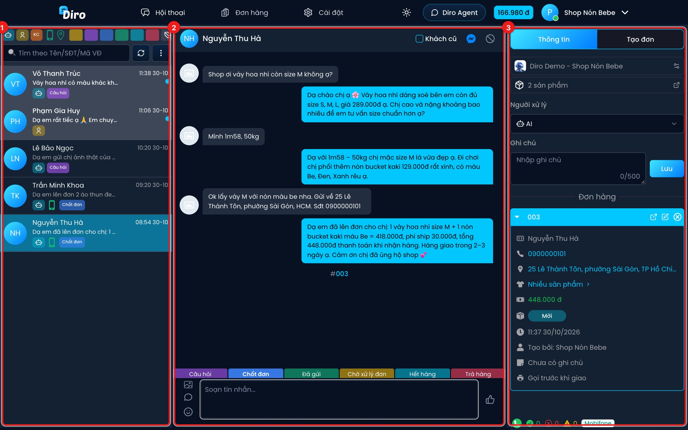
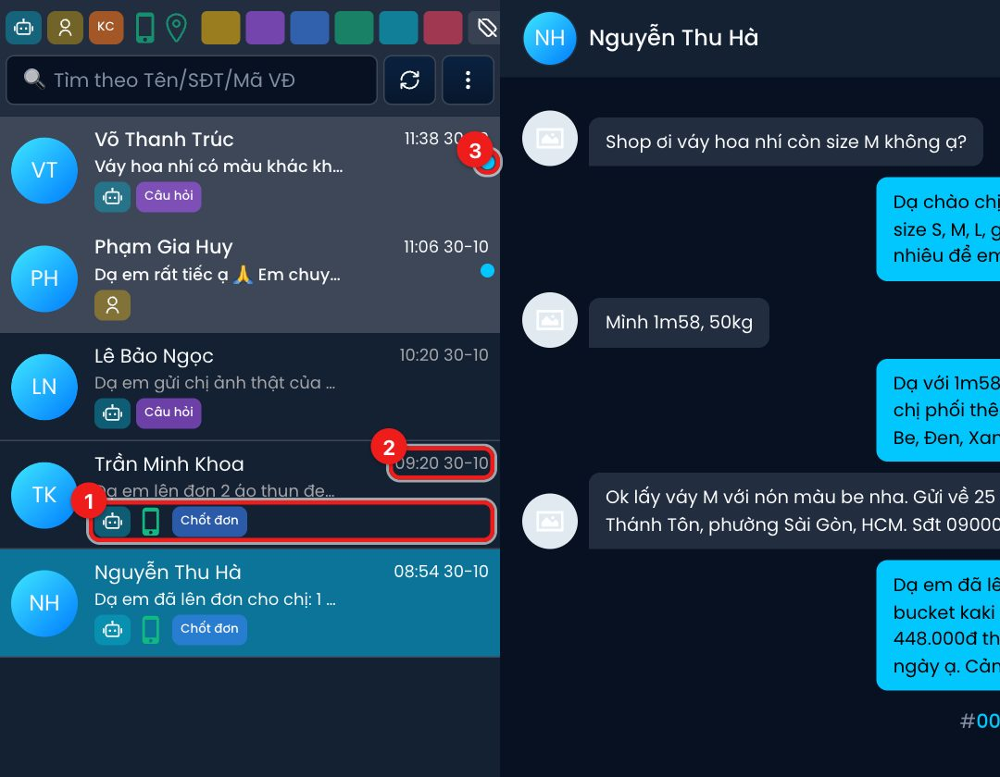
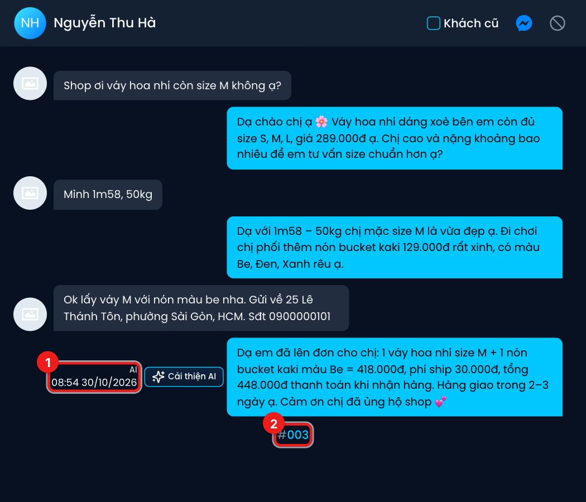
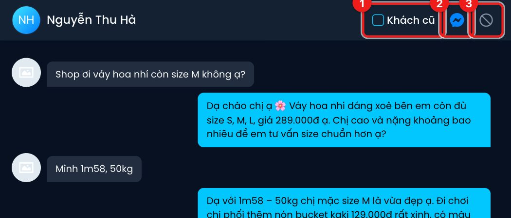

# Màn hình hội thoại

Màn hình **Hội thoại** gom toàn bộ tin nhắn khách gửi tới trang của bạn vào một chỗ. Bạn thấy
được khách nào đang được AI trả lời, khách nào đang chờ nhân viên, và đọc lại từng tin nhắn.

## Bố cục 3 cột

1. **Danh sách hội thoại** — mỗi dòng là một khách. Phía trên có hàng nút lọc và ô tìm kiếm
   (xem [Tìm kiếm và lọc hội thoại](./tim-kiem-va-loc.md)).
2. **Khung chat** — toàn bộ tin nhắn của khách đang chọn, thanh gắn thẻ và ô soạn tin ở dưới cùng.
3. **Cột Thông tin / Tạo đơn** — trang đang chat, người xử lý, ghi chú, các đơn hàng của khách và
   form tạo đơn (xem [Người xử lý, ghi chú và đơn hàng](./thong-tin-khach-hang.md)).

Thanh trên cùng có 3 mục:

- **Hội thoại** — màn hình này.
- **Đơn hàng** — mở trang quản lý đơn của trang đang chat ở thẻ trình duyệt mới.
- **Cài đặt** — mở phần cài đặt chat: [Trả lời nhanh](./tra-loi-nhanh.md) và [Cấu hình chung](./cau-hinh-chung.md).

:::tip
Danh sách hội thoại cập nhật tự động khi có tin mới, bạn không cần tải lại trang. Hội thoại có tin
mới nhất luôn nằm trên cùng.
:::

## Đọc một dòng hội thoại

Mỗi dòng có tên khách, tin nhắn cuối cùng và:

1. **Hàng biểu tượng** của hội thoại, theo thứ tự:
   - Biểu tượng **robot** — hội thoại đang do **AI** trả lời. Biểu tượng **người** — đang do
     **Nhân viên** xử lý, AI tạm dừng trả lời khách này.
   - Biểu tượng **điện thoại xanh** — khách đã để lại số điện thoại.
   - Biểu tượng **ghi chú** — hội thoại có ghi chú nội bộ.
   - Chữ **KC** — khách cũ. KC xanh: từng nhận hàng; KC đỏ: từng trả hàng (bom hàng); KC cam: có cả hai.
   - Các **thẻ** đang gắn (Câu hỏi, Chốt đơn…). Chỗ hẹp chỉ hiện 2 thẻ đầu, "Chờ xử lý đơn" viết tắt là **CXLĐ**.
2. **Thời gian** tin nhắn cuối.
3. **Chấm xanh** — hội thoại có tin mới bạn chưa xem. Dòng chưa xem cũng có chữ đậm hơn.

## Đọc tin nhắn

- Tin của khách nằm bên trái, tin của shop nằm bên phải.
- Rê chuột vào một tin của shop để thấy **ai gửi** và lúc nào (1): **AI**, **Tự động** (tin tự
  động như kéo tương tác, chào khách), hoặc tên nhân viên đã gửi từ Diro. Tin nhân viên trả lời
  thẳng trong Messenger/Meta Business Suite chỉ hiện là **Nhân viên**.
- Cạnh tin của AI có nút **Cải thiện AI** để góp ý cách AI nên trả lời lần sau.
- Khi có đơn được tạo trong hội thoại, khung chat chèn một dòng **mã đơn** (2), ví dụ `#003`.
- Ảnh đại diện nhỏ của khách ở góc phải tin nhắn cho biết khách **đã xem** tới tin đó.
- Dòng "AI cảm thấy không cần thiết phải trả lời tin nhắn" nghĩa là AI cố ý không trả lời (ví dụ
  khách chỉ thả like hay nói "ok" sau khi đã lên đơn).

## Thanh trên cùng của khung chat

1. **Khách cũ** — đánh dấu khách này là khách cũ. Xem [Khách cũ và chặn khách](./khach-cu-va-chan-khach.md).
2. **Mở Messenger** — mở đúng cuộc trò chuyện này trên Messenger của Fanpage.
3. **Chặn khách** — chặn khách hay bom hàng.

:::note
Mở một hội thoại là đánh dấu hội thoại đó **đã xem**. Muốn đánh dấu đã xem cả loạt, dùng
**Đánh dấu đã xem tất cả** trong nút ⋮ (xem [Tìm kiếm và lọc hội thoại](./tim-kiem-va-loc.md)).
:::

## Câu hỏi thường gặp

**Danh sách trống, có dòng "Hoặc trang chưa được kích hoạt…"?** Trang chưa có Chat Agent hoặc chưa
bật AI. Hãy tạo Chat Agent và bật AI cho trang để Diro bắt đầu nhận tin nhắn.

**Số dư ở góc trên có tam giác vàng nhấp nháy?** Ví không đủ tiền, Chat Agent tạm ngừng trả lời.
Xem mục Tài khoản & ví để nạp thêm.
