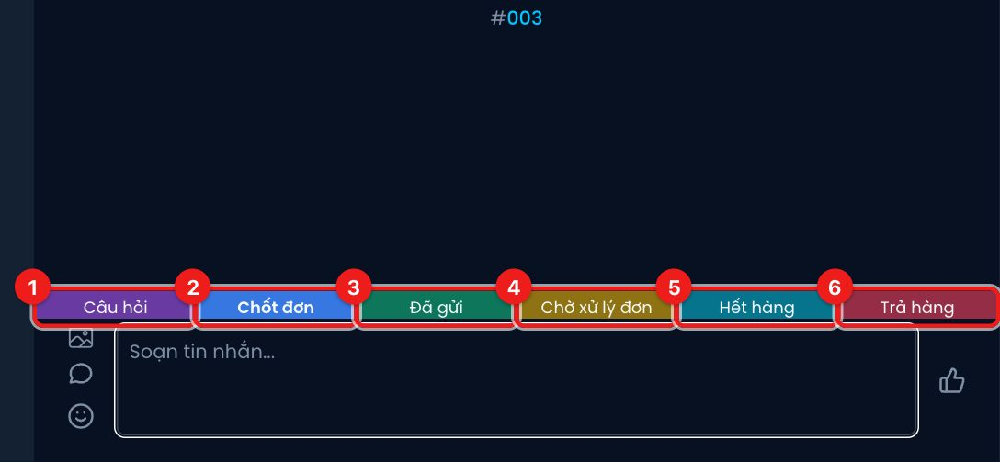

# Thẻ hội thoại

Thẻ giúp bạn phân loại khách theo tình trạng: đang hỏi, đã chốt, đã gửi hàng, đang có vấn đề với
đơn… Thẻ hiện trên dòng hội thoại trong danh sách và dùng được để lọc (xem
[Tìm kiếm và lọc hội thoại](./tim-kiem-va-loc.md)).

Thanh thẻ nằm ngay trên ô soạn tin. Thẻ đang gắn có màu đậm và chữ in đậm. Bấm một thẻ để gắn,
bấm lần nữa để gỡ — thay đổi được **lưu ngay**, không cần bấm Lưu.

| # | Thẻ | Ý nghĩa | Ai gắn |
|---|---|---|---|
| 1 | **Câu hỏi** | Khách đang hỏi, cần theo dõi thêm | Bạn tự gắn |
| 2 | **Chốt đơn** | Khách đã chốt, đơn đã được tạo | Tự gắn khi AI hoặc nhân viên tạo đơn trong hội thoại; bạn cũng gắn tay được |
| 3 | **Đã gửi** | Hàng đã được gửi đi | Tự gắn khi đơn chuyển sang **Chờ lấy hàng** (đã đẩy sang đơn vị vận chuyển); gắn tay được |
| 4 | **Chờ xử lý đơn** | Giao hàng không thành, hãng vận chuyển đang chờ shop quyết định giao lại hay hoàn | **Chỉ hệ thống** gắn và gỡ theo trạng thái vận đơn. Bạn không bấm được thẻ này |
| 5 | **Hết hàng** | Sản phẩm khách hỏi đang hết | Bạn tự gắn |
| 6 | **Trả hàng** | Đơn bị hoàn / khách trả hàng | Tự gắn khi đơn hoàn (nếu shop tắt tuỳ chọn xoá thẻ); gắn tay được |

## Thẻ tự được dọn khi đơn xong

Khi đơn của khách **giao thành công** hoặc **đã hoàn**, Diro tự **gỡ toàn bộ thẻ** của hội thoại
để danh sách gọn lại — trừ khi khách còn đơn khác đang chạy. Tình trạng khách cũ / từng bom hàng
vẫn được giữ ở nhãn **KC**.

Muốn giữ nguyên thẻ, tắt tuỳ chọn **Cho phép xoá tag (thẻ) của cuộc hội thoại khi vận đơn hoàn tất**
ở [Cấu hình chung](./cau-hinh-chung.md).

:::tip
Khách đang có thẻ **Chờ xử lý đơn**, **Hết hàng** hoặc **Trả hàng** thì Diro **không** tự trả hội
thoại về cho AI khi khách nhắn lại — những việc này cần người xử lý.
:::
