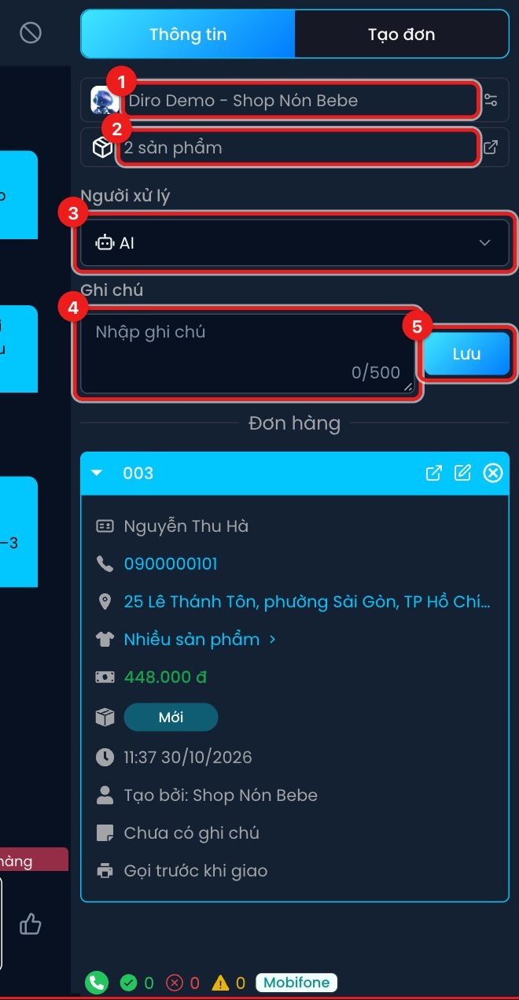
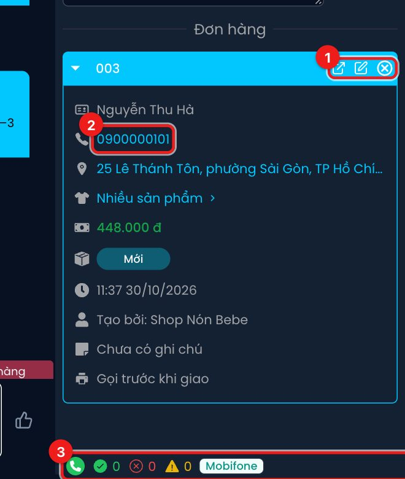
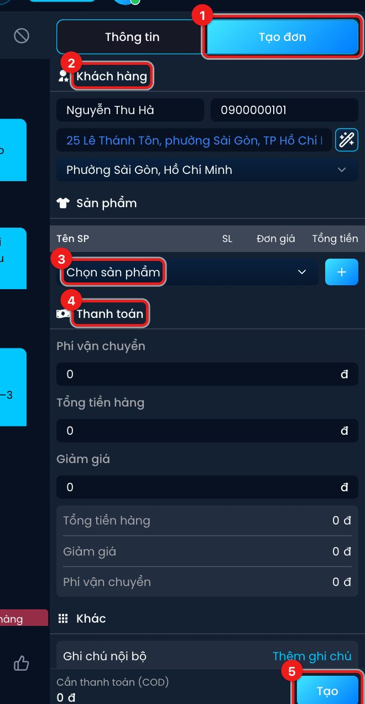

# Người xử lý, ghi chú và đơn hàng

Cột bên phải màn hình hội thoại có 2 thẻ: **Thông tin** (ai đang xử lý khách, ghi chú, các đơn của
khách) và **Tạo đơn** (form lên đơn ngay trong lúc chat).

## Thẻ Thông tin

1. **Tên trang** đang chat. Bấm để mở thiết lập Chat Agent của trang này.
2. **Sản phẩm** khách đang quan tâm (AI nhận ra từ cuộc trò chuyện). Bấm để mở danh sách sản phẩm của trang.
3. **Người xử lý** — chọn **AI** hoặc **Nhân viên**.
4. **Ghi chú** — ghi chú nội bộ về khách (tối đa 500 ký tự). Khách không thấy ghi chú này.
5. Bấm **Lưu** để lưu ghi chú.

### Chuyển người xử lý AI ↔ Nhân viên

- **AI**: AI tự trả lời mọi tin khách nhắn tới.
- **Nhân viên**: AI **ngừng trả lời** khách này, nhân viên tự nhắn. Dùng khi khách khiếu nại, hỏi
  điều AI không nắm, hoặc bạn muốn tự chốt.

Đổi ở ô **Người xử lý** là **lưu ngay** (có thông báo "Cập nhật thành công"), không cần bấm Lưu.

AI cũng tự chuyển hội thoại sang **Nhân viên** trong một số trường hợp, ví dụ không xác định được
khách muốn mua sản phẩm nào, hay khách đang bị chặn mà vẫn muốn chốt đơn. Trong khung chat sẽ có
dòng "Cuộc hội thoại được chuyển cho Nhân Viên" kèm lý do. Tuỳ thiết lập Chat Agent, hội thoại có
thể tự quay về AI khi khách nhắn lại sau một khoảng thời gian dài.

:::tip
Bật **Thông báo Telegram** trong trang Tài khoản để nhận tin mỗi khi AI chuyển một hội thoại cho
nhân viên.
:::

### Đơn hàng của khách

Mỗi đơn của khách là một thẻ, đơn mới nhất mở sẵn. Thẻ cho biết tên, số điện thoại, địa chỉ, sản
phẩm, tổng tiền thu hộ, trạng thái đơn, thời gian tạo, người tạo, ghi chú và cách giao.

1. Nhóm nút trên đầu thẻ, từ trái qua phải:
   - **Xem chi tiết** — mở trang chi tiết đơn.
   - **Vì sao AI lên đơn như này?** — chỉ có ở đơn do AI tạo, giải thích AI đã tính giá ra sao.
   - **Sửa đơn** — mở form sửa đơn.
   - **Huỷ đơn** (dấu ×) — huỷ đơn, và huỷ luôn vận đơn bên hãng vận chuyển nếu đã gửi. Hãy chắc
     chắn trước khi bấm. Đơn đã giao / đã hoàn không còn nút này.
2. Bấm vào **số điện thoại** (hoặc địa chỉ, mã vận đơn) để copy.
3. Dòng dưới cùng: số lần **giao thành công** (✓ xanh), **giao thất bại** (× đỏ), số **cảnh báo**
   (△ vàng) của số điện thoại này trên toàn hệ thống Diro, và **nhà mạng**. Rê chuột lên con số để
   xem chi tiết. Số thất bại cao là dấu hiệu khách hay bom hàng.

Thẻ đơn có viền cam và dòng "Đơn liên kết của …" là đơn của **trang khác cùng shop** khớp theo số
điện thoại — chỉ để xem, không sửa được từ đây.

Hội thoại chưa có đơn nào sẽ hiện "Chưa có đơn hàng nào" và nút **Tạo đơn**.

## Thẻ Tạo đơn

1. Bấm thẻ **Tạo đơn**.
2. **Khách hàng** — tên, số điện thoại, địa chỉ được điền sẵn từ hội thoại (nếu có). Nút đũa thần
   cạnh ô địa chỉ giúp tách địa chỉ thành phường / tỉnh.
3. **Sản phẩm** — chọn sản phẩm, bấm **+** để thêm dòng.
4. **Thanh toán** — phí vận chuyển, giảm giá; tổng **Cần thanh toán (COD)** hiện ở dưới cùng.
5. Bấm **Tạo** để tạo đơn.

Cách điền chi tiết từng ô được hướng dẫn ở mục Đơn hàng. Đơn tạo ở đây gắn với hội thoại: khung chat
hiện mã đơn, hội thoại được gắn thẻ **Chốt đơn**.
