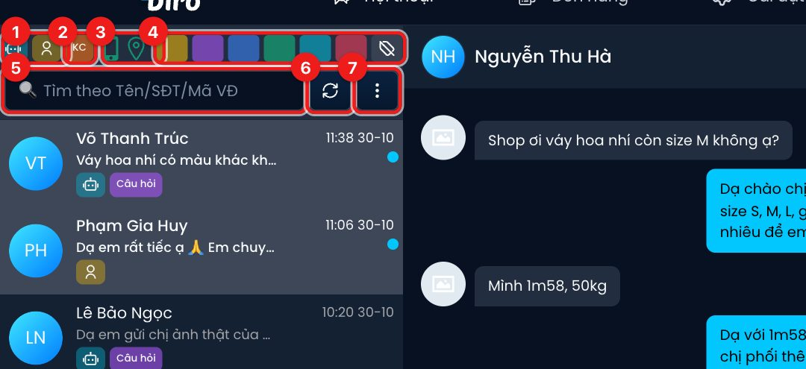
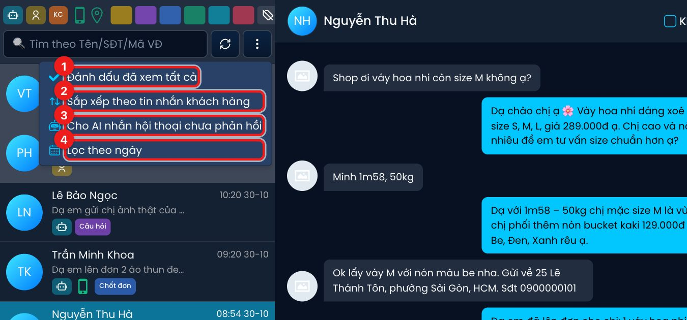
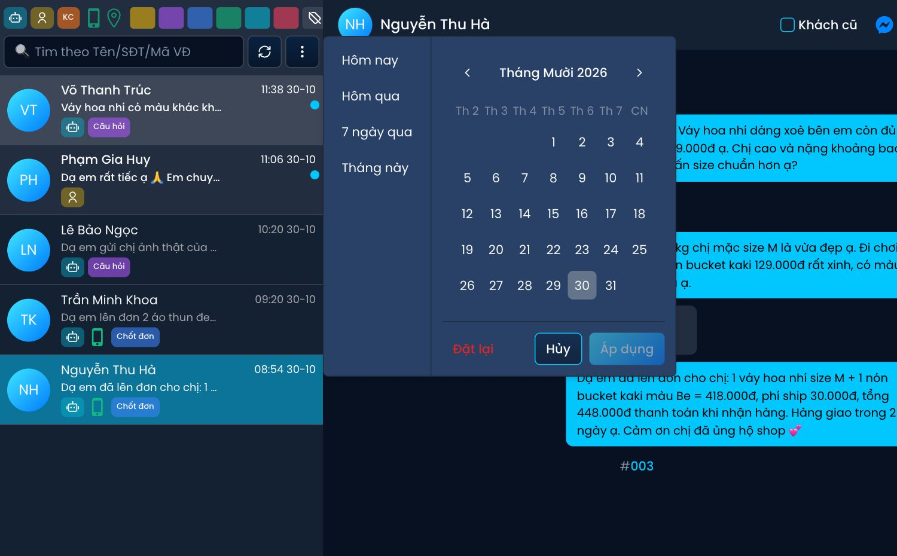
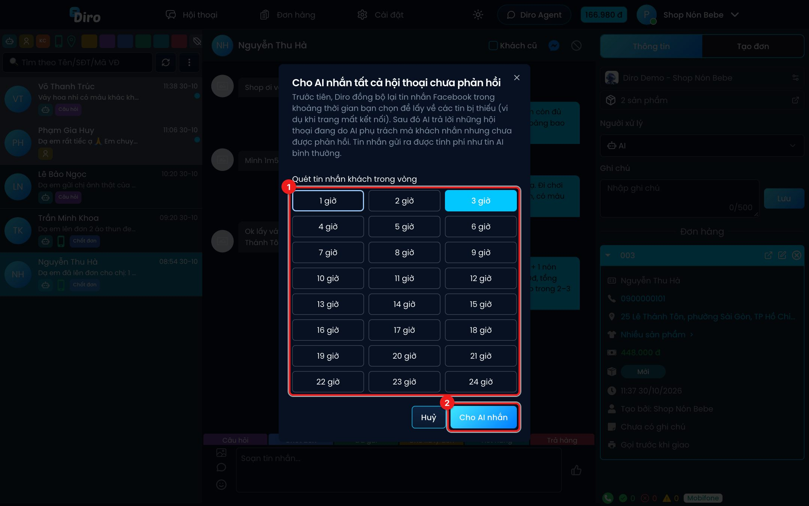

# Tìm kiếm và lọc hội thoại

Khi trang có nhiều khách nhắn cùng lúc, bạn dùng ô tìm kiếm và hàng nút lọc phía trên danh sách để
chỉ hiện đúng nhóm hội thoại cần xử lý: khách đang chờ nhân viên, khách đã cho số điện thoại, khách
đang chờ xử lý đơn…

## Hàng nút lọc

Mỗi nút là một công tắc: bấm để bật (nút có viền trắng), bấm lần nữa để tắt. Rê chuột vào nút để
xem tên. Bật nhiều nút cùng lúc thì danh sách chỉ còn hội thoại thoả **tất cả** điều kiện, riêng
các nút cùng nhóm (ví dụ 2 thẻ) thì thoả **một trong** các nút là đủ.

1. **AI** (robot) và **Nhân viên** (hình người) — chỉ hiện hội thoại đang do AI, hoặc đang do nhân viên xử lý.
2. **KC – Khách cũ** — bấm xoay vòng 3 chế độ:
   - Lần 1: **chỉ hiện khách cũ**.
   - Lần 2: **trừ khách cũ ra** (chữ KC bị gạch ngang).
   - Lần 3: bỏ lọc.
3. **Điện thoại** — chỉ hiện hội thoại khách đã để lại số điện thoại. **Ghim bản đồ** — chỉ hiện
   hội thoại đã có địa chỉ.
4. **Các ô màu** — lọc theo thẻ, theo thứ tự: Chờ xử lý đơn (vàng đậm), Câu hỏi (tím), Chốt đơn
   (xanh dương), Đã gửi (xanh lá), Hết hàng (xanh ngọc), Trả hàng (đỏ). Ô cuối có biểu tượng thẻ
   gạch chéo là **Không gắn thẻ** — chỉ hiện hội thoại chưa có thẻ nào.

:::tip Lọc số điện thoại để gọi khách mới
Khi bật lọc **Điện thoại** mà để nút KC ở chế độ mặc định, Diro tự **bỏ khách cũ** ra khỏi danh
sách — tiện để nhân viên gọi chốt đơn khách mới. Muốn xem cả khách cũ, bấm KC sang chế độ
"chỉ hiện khách cũ".
:::

## Tìm kiếm

5. Gõ **tên khách, số điện thoại hoặc mã vận đơn** vào ô **Tìm theo Tên/SĐT/Mã VĐ** rồi nhấn
   **Enter**. Bấm dấu **×** trong ô (hoặc xoá hết chữ) để bỏ tìm kiếm.
6. Nút **Làm mới** tải lại danh sách hội thoại từ máy chủ.
7. Nút **⋮** mở thêm các tuỳ chọn bên dưới.

## Menu ⋮

1. **Đánh dấu đã xem tất cả** — xoá chấm "chưa xem" của mọi hội thoại trên trang.
2. **Sắp xếp theo tin nhắn khách hàng** — xếp hội thoại theo thời điểm **khách** nhắn gần nhất
   (thay vì tin nhắn bất kỳ, kể cả tin AI). Có dấu ✓ là đang bật.
3. **Cho AI nhắn hội thoại chưa phản hồi** — xem bên dưới.
4. **Lọc theo ngày** — xem bên dưới.

### Lọc theo ngày

Chọn nhanh **Hôm nay**, **Hôm qua**, **7 ngày qua**, **Tháng này**, hoặc bấm ngày bắt đầu và ngày
kết thúc trên lịch rồi bấm **Áp dụng**. Danh sách chỉ còn hội thoại có tin nhắn trong khoảng đó
(nếu đang bật "Sắp xếp theo tin nhắn khách hàng" thì xét theo tin của khách).

Khi đang lọc ngày, dưới ô tìm kiếm hiện một nhãn như `01/10 – 07/10`; bấm **×** trên nhãn để bỏ lọc.

:::note
Bộ lọc ngày không được nhớ lại khi bạn tải lại trang — để tránh quên tắt mà bỏ sót hội thoại mới.
:::

### Cho AI nhắn hội thoại chưa phản hồi

Dùng khi trang bị mất kết nối một thời gian hoặc AI bị gián đoạn (ví dụ hết tiền) và có khách nhắn
mà chưa ai trả lời.

1. Chọn khoảng thời gian cần quét (từ **1 giờ** tới **24 giờ**).
2. Bấm **Cho AI nhắn**.

Diro sẽ đồng bộ lại tin nhắn Facebook trong khoảng đó để lấy các tin bị thiếu, rồi cho AI trả lời
những hội thoại **đang do AI phụ trách** mà khách nhắn nhưng chưa được phản hồi. Hội thoại đang do
nhân viên xử lý không bị đụng tới. Tin AI gửi ra được tính phí như tin AI bình thường.

:::caution
Thao tác này gửi tin nhắn thật tới khách. Nếu trang đang được AI xử lý dở một lượt khác, Diro báo
"Các trang đang được AI xử lý, vui lòng đợi" — chờ một lúc rồi thử lại.
:::
