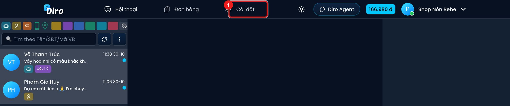
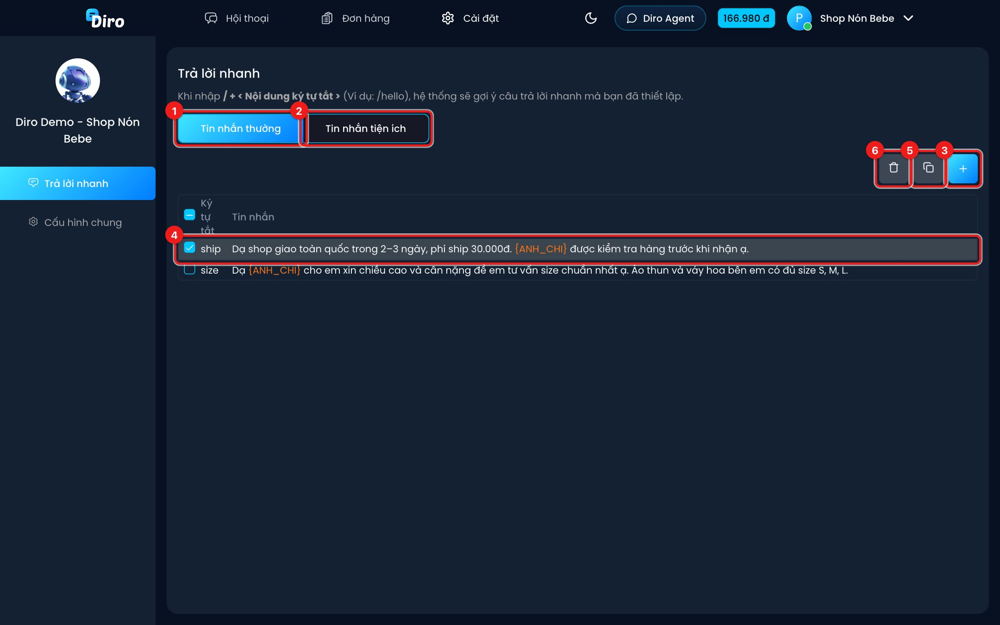
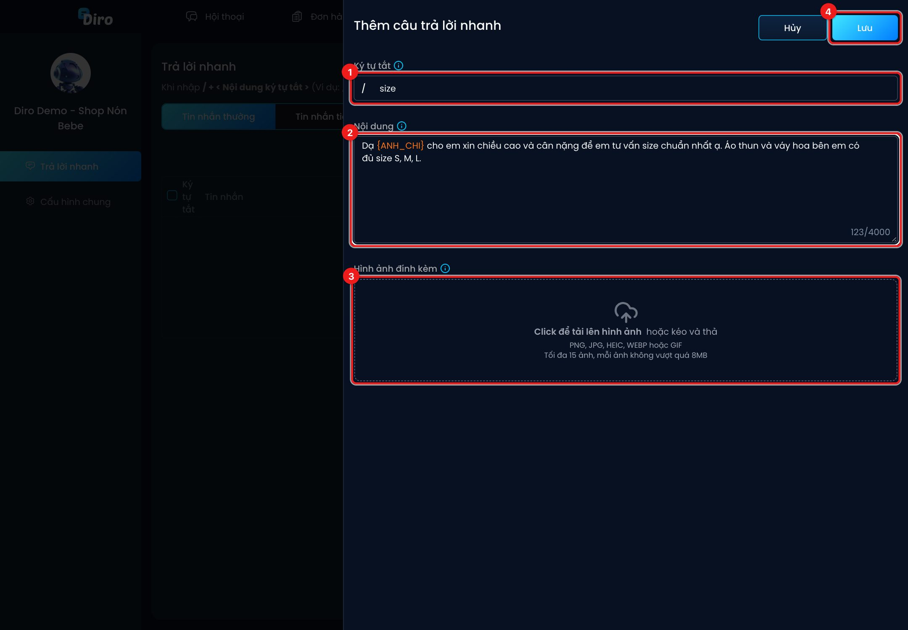
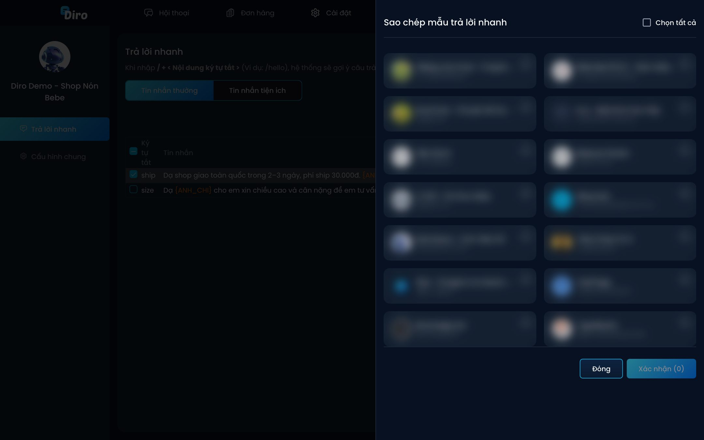
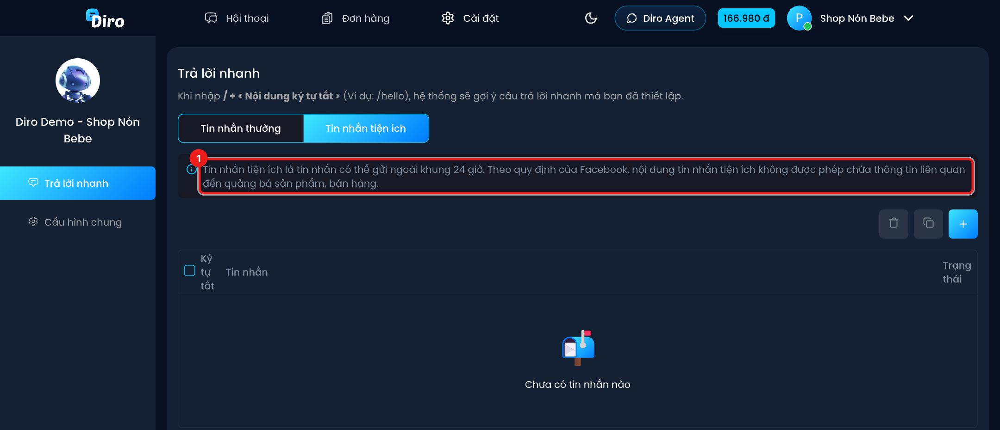

# Trả lời nhanh

**Trả lời nhanh** là các mẫu câu soạn sẵn (có thể kèm ảnh). Trong khung chat, bạn gõ `/` + ký tự tắt
để chèn mẫu thay vì gõ lại từ đầu — ví dụ gõ `/ship` để chèn câu báo phí ship.

Mẫu trả lời nhanh lưu **theo từng trang**.

## Mở trang Trả lời nhanh

Trong màn hình Hội thoại của một trang, bấm **Cài đặt** (1) trên thanh trên cùng. Trang mở ra mục
**Trả lời nhanh**.

1. Thẻ **Tin nhắn thường** — mẫu bình thường, dùng trong 24 giờ kể từ tin cuối của khách.
2. Thẻ **Tin nhắn tiện ích** — xem [bên dưới](#tin-nhắn-tiện-ích).
3. Nút **+** — thêm mẫu mới.
4. Mỗi dòng là một mẫu: ký tự tắt và nội dung. Bấm vào dòng để sửa; tick ô vuông đầu dòng để chọn.
5. **Sao chép** — chép các mẫu đang chọn sang trang khác.
6. **Xoá** — xoá các mẫu đang chọn (có bước xác nhận).

## Thêm mẫu

1. **Ký tự tắt** — chữ bạn sẽ gõ sau dấu `/`, ví dụ `size`. Không bắt đầu bằng số, không có khoảng trắng.
2. **Nội dung** — câu trả lời (tối đa 4.000 ký tự). Có thể dùng các chỗ trống tự điền (xem bảng dưới).
3. **Hình ảnh đính kèm** — bấm hoặc kéo thả ảnh vào (PNG, JPG, HEIC, WEBP, GIF; tối đa 15 ảnh, mỗi
   ảnh dưới 8MB). Kéo thả để đổi thứ tự — ảnh được gửi theo đúng thứ tự này.
4. Bấm **Lưu**.

### Chỗ trống tự điền

Gõ đúng các cụm sau (cả dấu ngoặc nhọn), Diro thay bằng thông tin thật của khách khi chèn mẫu:

| Cụm | Được thay bằng |
|---|---|
| `{ANH_CHI}` | "anh" hoặc "chị" theo giới tính khách; không rõ thì "bạn" |
| `{SDT_KHACH_HANG}` | Số điện thoại khách |
| `{DIA_CHI_KHACH_HANG}` | Địa chỉ trên đơn mới nhất của khách |
| `{SO_LUONG_SAN_PHAM}` | Danh sách sản phẩm kèm số lượng trong đơn mới nhất, mỗi món một dòng, ví dụ "2 x Áo thun" |
| `{PHI_VAN_CHUYEN}` | Phí ship của đơn mới nhất, tính theo nghìn (30.000đ → "30k"; 0đ → "miễn phí") |
| `{TONG_COD}` | Tổng tiền thu hộ của đơn mới nhất, tính theo nghìn (448.000đ → "448k"; 0đ → "không thu tiền") |

Nếu hội thoại thiếu dữ liệu (chưa có số điện thoại, chưa có đơn…), Diro báo lỗi và không chèn mẫu,
để nhân viên không lỡ gửi câu bị cụt.

## Sao chép mẫu sang trang khác

1. Tick các mẫu cần chép trong danh sách, bấm nút **Sao chép**.
2. Tick các trang đích (hoặc **Chọn tất cả**), bấm **Xác nhận**.

## Tin nhắn tiện ích

Facebook chỉ cho Fanpage nhắn khách trong **24 giờ** kể từ tin cuối của khách. **Tin nhắn tiện ích**
là loại tin được gửi **ngoài khung 24 giờ**, ví dụ báo đơn đã gửi, nhắc khách nghe máy bưu tá.

- Mỗi mẫu tiện ích phải được **Facebook duyệt** trước khi dùng. Cột **Trạng thái** cho biết mẫu đã
  được duyệt chưa; mẫu chưa duyệt hiện mờ trong khung chat và không chọn được.
- Theo quy định của Facebook, nội dung **không được quảng bá sản phẩm, bán hàng**.
- Ngoài `{ANH_CHI}` và `{SDT_KHACH_HANG}`, mẫu tiện ích còn dùng được `{SDT_BUU_TA}` — số điện thoại
  bưu tá đang giao đơn.
- Sửa nội dung một mẫu tiện ích nghĩa là gửi Facebook duyệt lại.
- Trong khung chat, chọn mẫu tiện ích là **gửi ngay** cho khách.
