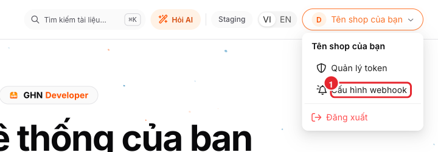
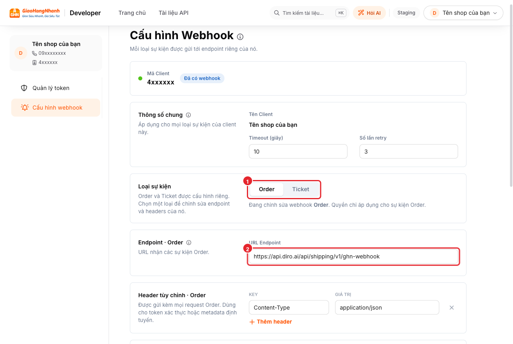
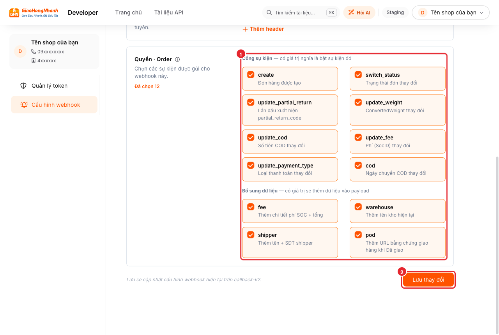

# Cài Webhook GHN (khi kết nối bằng Token)

Trang này dành cho shop **kết nối GHN bằng Token** (cách Nhập thủ công). Nếu bạn kết nối
**Qua OTP** thì không cần làm gì ở đây: GHN đã tự báo trạng thái đơn về Diro.

## Vì sao cần cài Webhook?

Khi kết nối bằng Token, đơn được tạo bằng tài khoản GHN riêng của bạn. GHN chỉ báo thay đổi
trạng thái đơn (đã lấy hàng, đang giao, giao thành công, hoàn hàng…) tới địa chỉ Webhook
cài trong **chính tài khoản GHN đó**. Chưa cài thì Diro chỉ tự kiểm tra lại khoảng
**10 phút một lần**, nên trạng thái đơn trên Diro sẽ cập nhật chậm.

Cài Webhook của Diro vào tài khoản GHN giúp trạng thái đơn cập nhật **ngay khi có thay đổi**.

:::caution Mỗi tài khoản GHN chỉ có một địa chỉ Webhook cho đơn hàng
Nếu bạn đang dùng một phần mềm khác cũng nhận Webhook từ GHN (phần mềm quản lý bán hàng,
phần mềm kho…), đổi sang địa chỉ của Diro sẽ làm phần mềm đó **không nhận được** trạng
thái đơn nữa. Trường hợp này, hãy [kết nối GHN Qua OTP](./ket-noi-don-vi-van-chuyen.md#qua-otp)
thay vì cài Webhook.
:::

## Các bước cài đặt

### Bước 1: Đăng nhập GHN Developer

Mở [developer.ghn.vn](https://developer.ghn.vn) và đăng nhập bằng **đúng số điện thoại** của
tài khoản GHN bạn đã lấy Token để kết nối với Diro.

### Bước 2: Mở Cấu hình webhook

Bấm vào tên tài khoản ở góc trên bên phải, chọn **Cấu hình webhook**.



### Bước 3: Điền địa chỉ Webhook của Diro

1. Ở mục **Loại sự kiện**, giữ lựa chọn **Order**.
2. Ở ô **URL Endpoint**, dán đúng địa chỉ sau:

```text
https://api.diro.ai/api/shipping/v1/ghn-webhook
```

3. Phần **Header tùy chỉnh** giữ nguyên mặc định (`Content-Type: application/json`).



### Bước 4: Chọn sự kiện và lưu

1. Ở mục **Quyền · Order**, tích chọn **tất cả** các ô (Đơn hàng được tạo, Trạng thái đơn
   thay đổi, Số tiền COD thay đổi…).
2. Bấm **Lưu thay đổi**.



## Kiểm tra

Tạo một đơn GHN từ Diro. Khi bưu tá GHN lấy hàng, trạng thái đơn trên Diro đổi sang
**Đã lấy hàng** sau vài giây thay vì phải chờ tới 10 phút.

## Câu hỏi thường gặp

**Tôi kết nối Qua OTP, có cần cài Webhook không?**
Không. Với kết nối Qua OTP, GHN đã tự báo trạng thái đơn về Diro.

**Tôi có nhiều tài khoản GHN kết nối bằng Token?**
Làm lại các bước trên cho **từng tài khoản**, mỗi tài khoản đăng nhập bằng số điện thoại riêng.

**Tôi không muốn tự cài?**
Hãy xoá kết nối Token và [kết nối lại Qua OTP](./ket-noi-don-vi-van-chuyen.md#qua-otp).
Các vận đơn đã tạo không bị ảnh hưởng.
