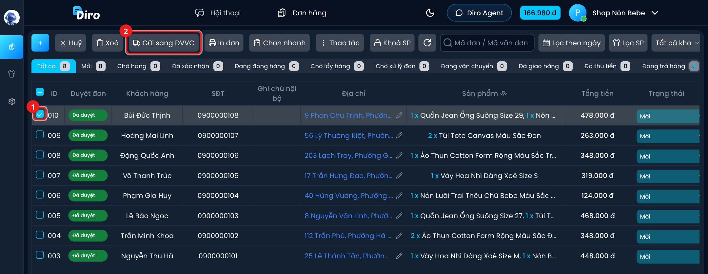
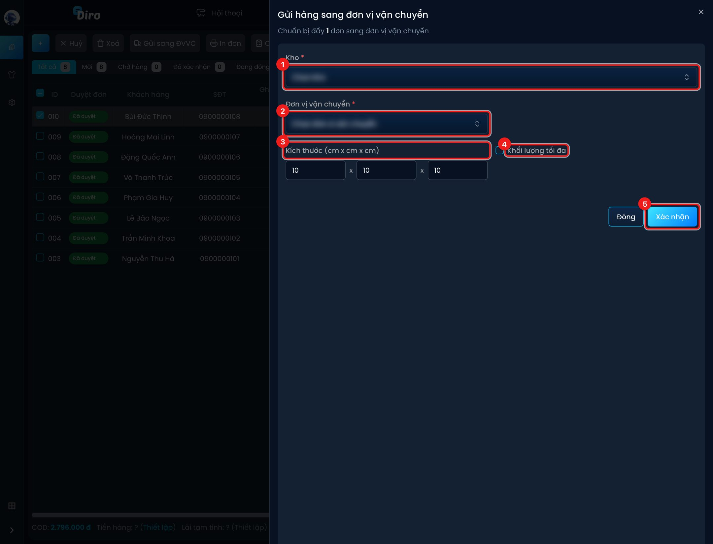
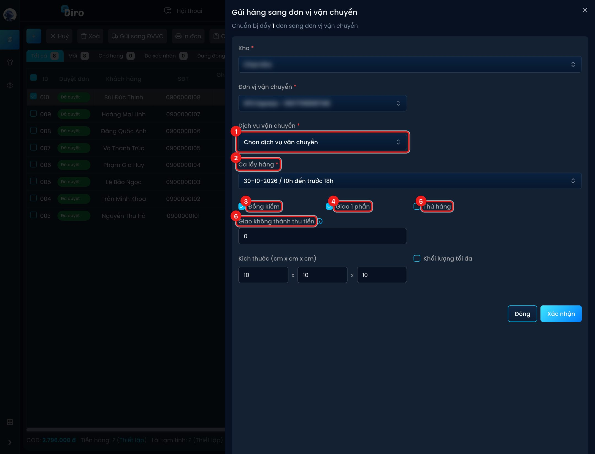
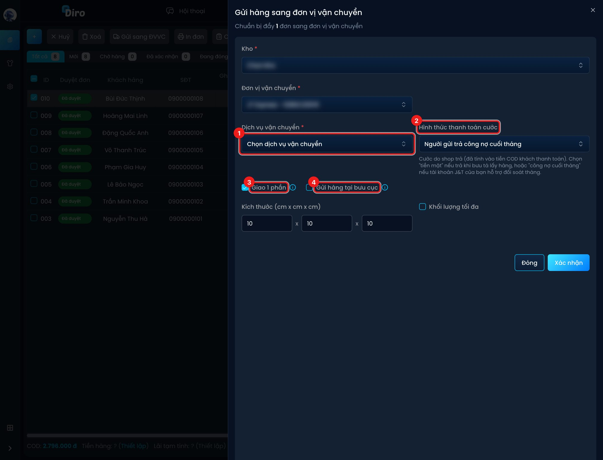
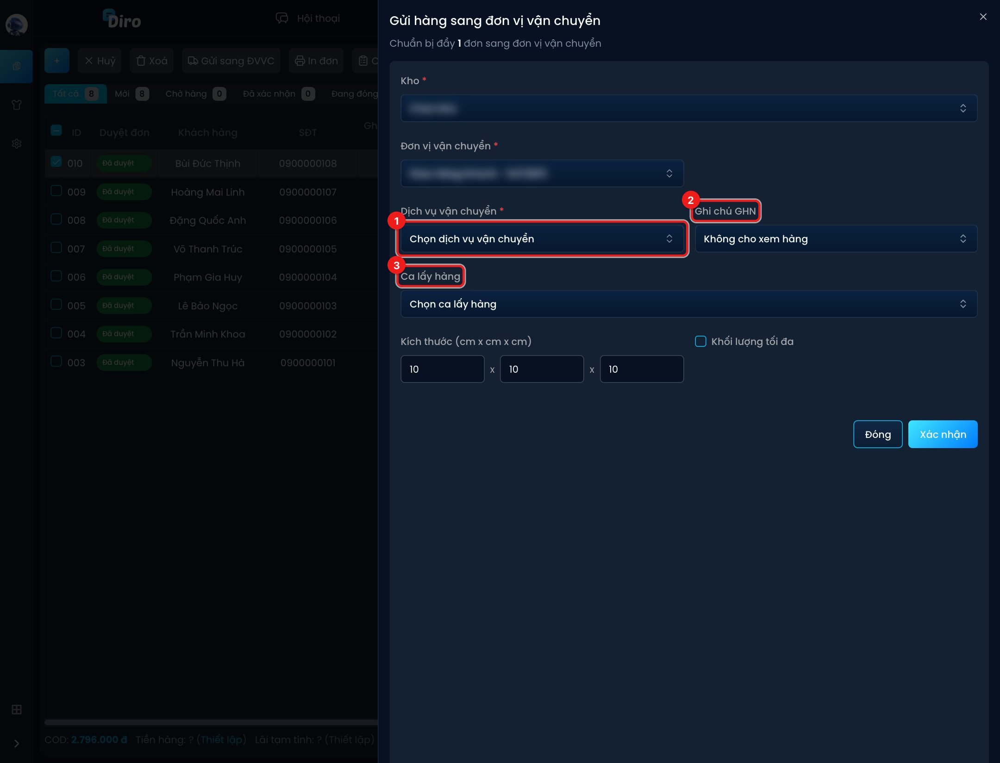
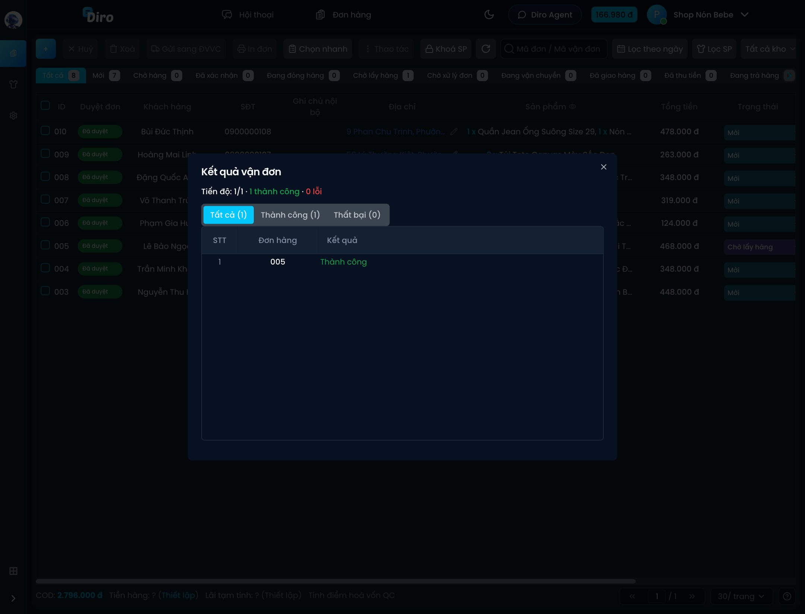

# Gửi đơn sang đơn vị vận chuyển

Khi đơn đã chốt, bạn tạo vận đơn ngay trên danh sách đơn hàng. Bạn gửi được một đơn hoặc
nhiều đơn một lúc. Diro chuyển thông tin người nhận, tiền thu hộ (COD), khối lượng và ghi chú
sang hãng, rồi lưu lại mã vận đơn.

:::note Trước khi bắt đầu
- Đã [kết nối ít nhất một tài khoản hãng](./ket-noi-don-vi-van-chuyen.md).
- Đã có **kho hàng** (địa chỉ lấy hàng) trong **Thiết lập → Kho hàng**.
:::

## Bước 1: Chọn đơn và bấm Gửi sang ĐVVC

Vào **Đơn hàng**.

1. Tick ô vuông ở đầu các đơn muốn gửi.
2. Bấm **Gửi sang ĐVVC** trên thanh công cụ.

Khung **Gửi hàng sang đơn vị vận chuyển** mở ra, dòng đầu ghi rõ bạn chuẩn bị đẩy bao nhiêu đơn.

## Bước 2: Điền thông tin chung

1. **Kho**: kho lấy hàng. Bưu tá sẽ tới địa chỉ kho này.
2. **Đơn vị vận chuyển**: chọn tài khoản hãng (hiện theo tên gợi nhớ). Nếu tài khoản có
   [hạn mức](./han-muc-van-chuyen.md), ô bên cạnh hiện số hạn mức còn trống.
3. **Kích thước (cm x cm x cm)**: dài × rộng × cao của gói hàng. Mặc định 10 × 10 × 10.
4. **Khối lượng tối đa**: tick rồi nhập số gam nếu muốn đặt trần khối lượng. Khi tổng khối
   lượng sản phẩm vượt mức này, Diro gửi đúng mức trần sang hãng.
5. Bấm **Xác nhận** để tạo vận đơn.

Sau khi chọn hãng, khung hiện thêm các tuỳ chọn riêng của hãng đó (xem bên dưới).

:::tip Diro nhớ lựa chọn của bạn
Kho, tài khoản hãng, dịch vụ, kích thước và các ô tick được ghi nhớ trên trình duyệt cho
từng trang. Lần sau mở khung là đã điền sẵn.
:::

Khung có thể hiện cảnh báo màu vàng hoặc cam:

- **Có … đơn đang bị khoá**: đơn tạm khoá sẽ được bỏ qua, không gửi.
- **Có … đơn chưa được duyệt**: nhắc bạn kiểm tra trước khi gửi. Bạn vẫn gửi được.
- **Có đơn chứa sản phẩm của kho khác**: bạn phải tick **Tôi đã kiểm tra và xác nhận vẫn gửi
  các đơn này từ kho …** thì nút Xác nhận mới bấm được.

## Tuỳ chọn theo từng hãng

### SPX Express

1. **Dịch vụ vận chuyển**: Tiêu chuẩn hoặc Hoả tốc.
2. **Ca lấy hàng** (bắt buộc): ngày và khung giờ bưu tá tới lấy. Diro tự chọn ca sớm nhất.
3. **Đồng kiểm**: cho khách kiểm hàng cùng bưu tá. Mặc định bật.
4. **Giao 1 phần**: cho khách nhận một phần và hoàn phần còn lại. Mặc định bật. Diro tự tắt
   nếu đơn chỉ có 1 món, hoặc nếu tiền COD không chia khớp được theo giá từng món.
5. **Thử hàng**: cho khách mặc thử. Mặc định **tắt** vì SPX tính phí riêng cho dịch vụ này.
6. **Giao không thành thu tiền**: số tiền thu của khách khi khách từ chối nhận hàng. Để 0 nếu
   không thu. SPX không đảm bảo thu được 100%.

:::caution Hoả tốc
Dịch vụ **Hoả tốc** của SPX không hỗ trợ Đồng kiểm, Giao 1 phần, Thử hàng và Giao không thành
thu tiền. Khi chọn Hoả tốc, ô "Giao không thành thu tiền" bị ẩn và các tuỳ chọn kia không được gửi.
:::

### J&T Express

1. **Dịch vụ vận chuyển**: Chuyển phát nhanh, Tiết kiệm hoặc Hoả tốc.
2. **Hình thức thanh toán cước**:
   - **Người gửi trả tiền mặt**: shop trả cước bằng tiền mặt khi bưu tá tới lấy hàng.
   - **Người gửi trả công nợ cuối tháng**: trả theo đối soát cuối tháng (tài khoản J&T phải
     có công nợ).
3. **Giao 1 phần**: mặc định bật. J&T **chỉ cho chọn lúc tạo đơn**, không bật lại được sau đó.
   Tài khoản J&T của bạn phải đã đăng ký dịch vụ này.
4. **Gửi hàng tại bưu cục**: tick khi bạn tự mang hàng ra bưu cục. Không tick thì J&T tới lấy.

### Giao Hàng Nhanh (GHN)

1. **Dịch vụ vận chuyển**: hàng nhẹ hoặc hàng nặng.
2. **Ghi chú GHN**: **Không cho xem hàng** (mặc định), **Cho xem hàng, không cho thử** hoặc
   **Cho thử hàng**.
3. **Ca lấy hàng**: không bắt buộc.

### Viettel Post

- **Dịch vụ vận chuyển** (bắt buộc) lấy theo danh sách dịch vụ của Viettel Post.
- **Dịch vụ vận chuyển mở rộng** (không bắt buộc), chọn sau khi đã chọn dịch vụ chính.

### Giao Hàng Tiết Kiệm (GHTK)

GHTK không có tuỳ chọn riêng. Bạn chỉ cần chọn kho, tài khoản và kích thước.

## Bước 3: Xem kết quả

Bấm **Xác nhận** xong, hộp **Kết quả vận đơn** hiện tiến độ từng đơn với các thẻ **Tất cả**,
**Thành công**, **Thất bại** và **Cần xác nhận**. Trong lúc đang tạo, đừng đóng trang. Nếu bấm
đóng, Diro sẽ hỏi lại vì các đơn còn lại có thể chưa được tạo.

- Đơn **Thành công** chuyển sang trạng thái **Chờ lấy hàng** và có mã vận đơn.
- Đơn **Thất bại** hiện lý do. Sửa xong bấm **Thử lại đơn lỗi**.
- Đơn **Cần xác nhận** là khi khách đã yêu cầu huỷ đơn, hoặc khách còn đơn khác chưa hoàn tất
  (dễ là đơn trùng). Kiểm tra hội thoại rồi bấm **Xác nhận & vẫn đẩy** nếu chắc chắn muốn gửi.

## Đơn nào gửi được

Diro chỉ gửi đơn đang ở trạng thái **Mới**, **Chờ hàng**, **Đã xác nhận** hoặc **Đang đóng
hàng**. Các trường hợp bị chặn:

- Đơn **Đã hủy**, hoặc đơn đã có vận đơn (Diro không tạo vận đơn thứ hai).
- Đơn đang **tạm khoá**, hoặc có sản phẩm đang bị khoá.
- Đơn về từ **TikTok Shop**: TikTok tự giao nên không gửi sang hãng của Diro được.
- Đơn bật **Xuất hoá đơn** mà còn sản phẩm chưa có tên trên hoá đơn (xem mục Hoá đơn điện tử).
- Lô đơn làm vượt [hạn mức vận chuyển](./han-muc-van-chuyen.md).

## Diro gửi những gì sang hãng

- **Tiền thu hộ (COD)** = tổng tiền đơn (tiền hàng − giảm giá + phí ship). Muốn khách trả bao
  nhiêu thì sửa tổng tiền đơn trước khi gửi.
- **Khối lượng** = tổng khối lượng các sản phẩm × số lượng (trừ khi bạn đặt Khối lượng tối đa).
  Hãy khai khối lượng sản phẩm cho đúng để cước không bị lệch.
- **Ghi chú in đơn** của đơn được gửi kèm làm ghi chú cho bưu tá.
- Với SPX, đơn từ 3.000.000đ trở lên được tự động mua bảo hiểm hàng hoá.
