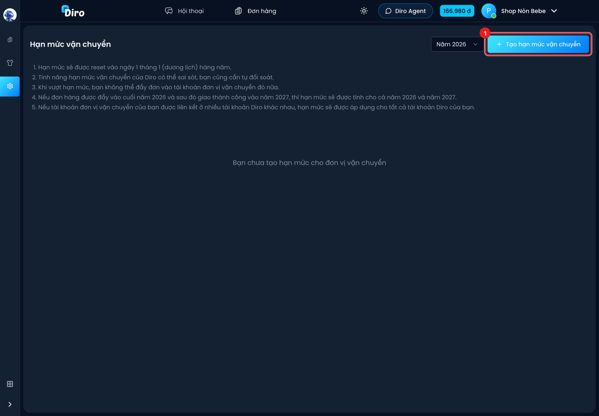
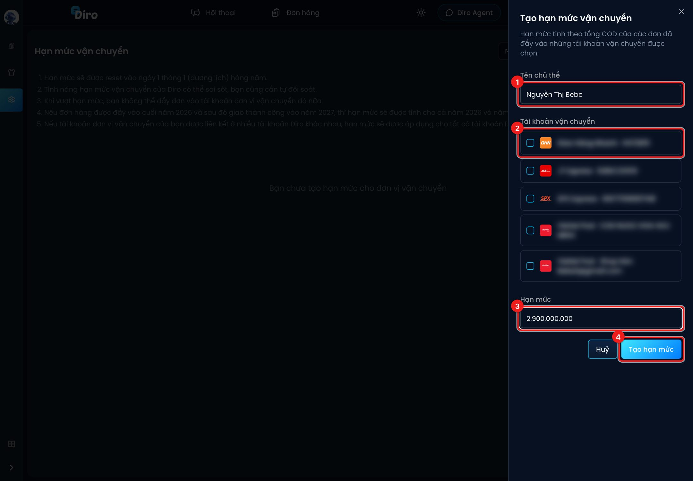

# Hạn mức vận chuyển

Hạn mức vận chuyển giúp bạn đặt **trần tổng tiền thu hộ (COD) trong một năm** cho một nhóm
tài khoản hãng. Ví dụ mỗi chủ thể kinh doanh chỉ được thu tối đa 2,9 tỷ một năm. Khi đã
chạm trần, Diro không cho gửi thêm đơn vào các tài khoản hãng đó nữa.

## Tạo hạn mức

Vào **Thiết lập → Vận chuyển → Hạn mức vận chuyển**.

1. Bấm **Tạo hạn mức vận chuyển**.

1. **Tên chủ thể**: người hoặc hộ kinh doanh đứng tên, ví dụ "Nguyễn Thị Bebe".
2. **Tài khoản vận chuyển**: tick các tài khoản hãng thuộc chủ thể này. Tài khoản đã nằm trong
   một hạn mức khác sẽ bị mờ, kèm dòng **Đã thuộc một hạn mức khác**. Mỗi tài khoản hãng chỉ
   thuộc được một hạn mức.
3. **Hạn mức**: tổng COD tối đa trong năm, ví dụ `2.900.000.000`.
4. Bấm **Tạo hạn mức**.

Sau khi tạo, mỗi hạn mức hiện thành một thẻ có thanh tiến độ. Phần đỏ là số đã dùng, phần
xanh là số còn trống, kèm dòng **Đã dùng …%**. Dùng nút bút chì để sửa, thùng rác để xoá hạn
mức. Ô **Năm** ở góc trên giúp bạn xem lại số liệu các năm trước.

## Hạn mức được tính thế nào

- Số **đã dùng** của một năm gồm COD của các đơn **gửi sang hãng** trong năm đó, cộng COD của
  đơn gửi từ năm trước nhưng **giao thành công** trong năm đó. Vì vậy đơn gửi cuối năm 2026
  mà giao xong năm 2027 sẽ được tính cho cả hai năm.
- Đơn **Đã trả hàng**, **Đã hủy** hoặc đã xoá không bị tính. Đơn **Đã trả hàng một phần**
  vẫn tính đủ COD.
- Hạn mức tự về 0 vào ngày 1/1 dương lịch mỗi năm.
- Nếu cùng một tài khoản hãng được kết nối ở nhiều tài khoản Diro, số đã dùng được cộng chung,
  và hạn mức áp dụng cho tất cả.

## Khi gửi đơn

Trong khung **Gửi hàng sang đơn vị vận chuyển**, cạnh ô chọn hãng có thêm ô **Hạn mức còn
trống (năm …)** cho tài khoản bạn chọn. Nếu lô đơn bạn sắp gửi làm vượt hạn mức, Diro báo
lỗi ngay trên khung và **chặn cả lô**. Muốn gửi tiếp, bạn tăng hạn mức hoặc chọn tài khoản
hãng khác.

:::caution
Như ghi chú trên trang: hạn mức của Diro **có thể sai sót**, bạn vẫn cần tự đối soát với hãng.
:::
