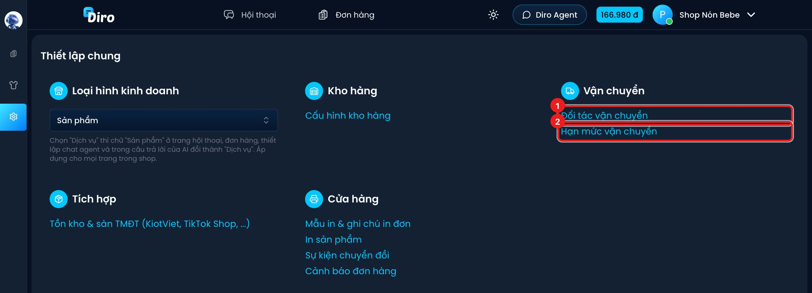

# Vận chuyển

Diro kết nối thẳng với tài khoản đơn vị vận chuyển (ĐVVC) của bạn. Bạn tạo vận đơn ngay
trên danh sách đơn hàng, không cần mở trang của hãng. Sau đó Diro tự cập nhật trạng thái
đơn theo hành trình giao hàng.

Diro đang hỗ trợ 5 hãng: **SPX Express**, **J&T Express**, **Viettel Post**,
**Giao Hàng Nhanh (GHN)** và **Giao Hàng Tiết Kiệm (GHTK)**.

Cả hai trang thiết lập đều nằm ở mục **Thiết lập → Vận chuyển**:

1. **Đối tác vận chuyển**: kết nối tài khoản các hãng.
2. **Hạn mức vận chuyển**: giới hạn tổng tiền thu hộ (COD) mỗi năm cho từng tài khoản hãng.

## Các trang trong mục này

- [Kết nối đơn vị vận chuyển](./ket-noi-don-vi-van-chuyen.md): mỗi hãng cần những thông tin gì.
- [Hạn mức vận chuyển](./han-muc-van-chuyen.md): đặt trần COD theo năm cho tài khoản hãng.
- [Gửi đơn sang đơn vị vận chuyển](./gui-don-sang-dvvc.md): tạo vận đơn và các tuỳ chọn dịch vụ
  như thử hàng, giao 1 phần, thu phí khi giao không thành.
- [Theo dõi trạng thái và hoàn hàng](./theo-doi-trang-thai.md): trạng thái tự cập nhật, SĐT
  bưu tá, huỷ vận đơn, hoàn hàng.
