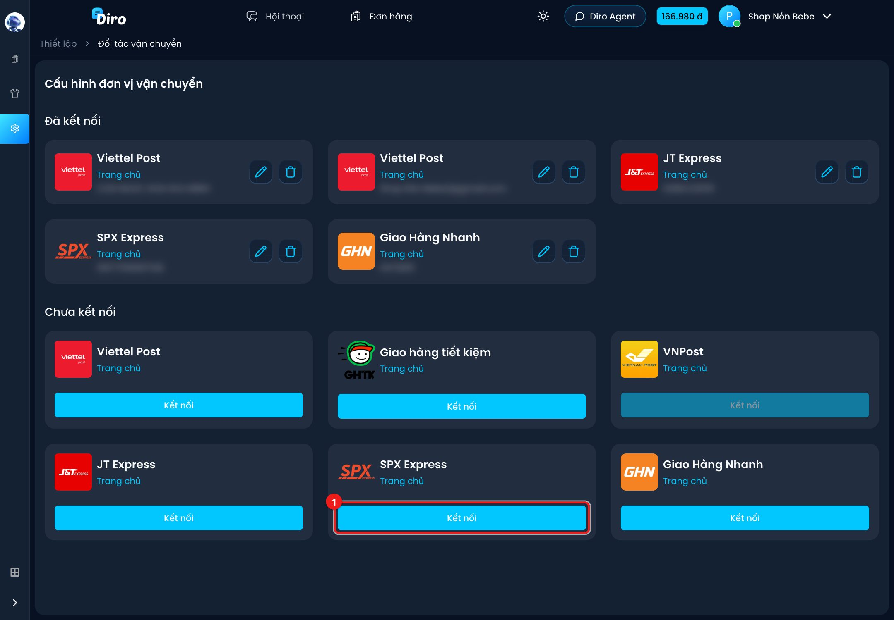
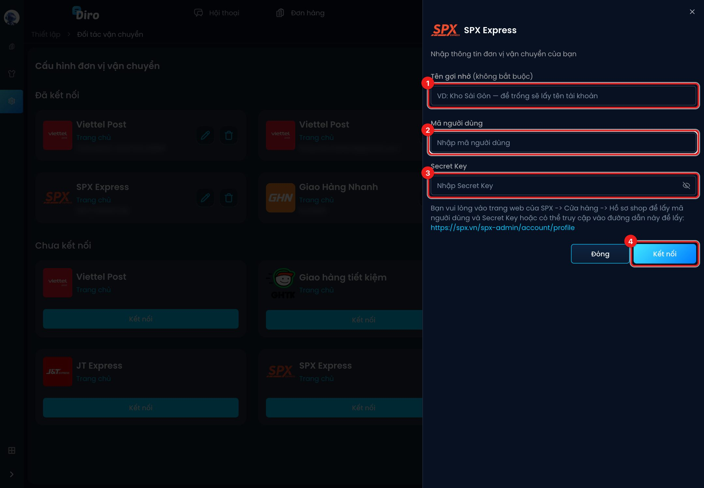
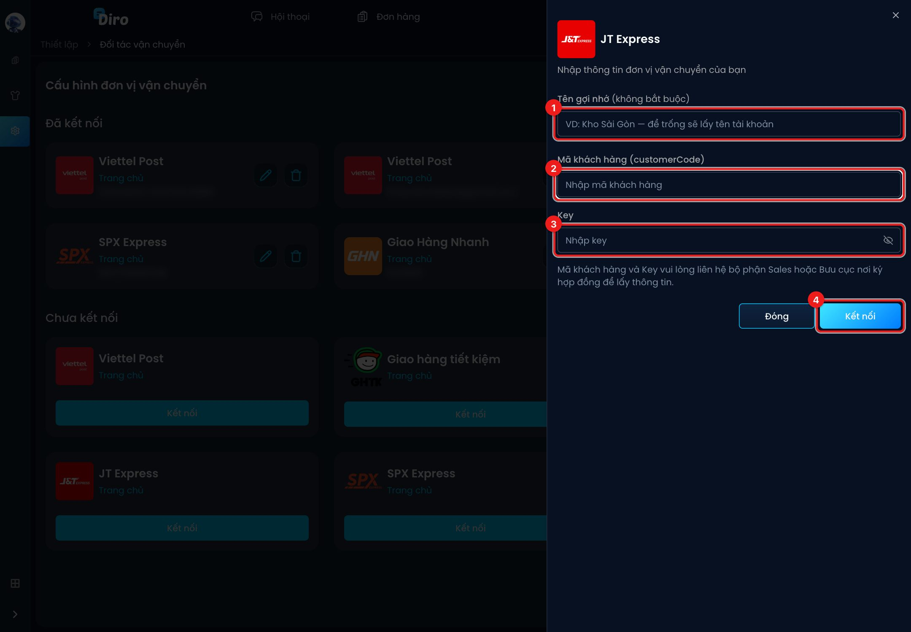
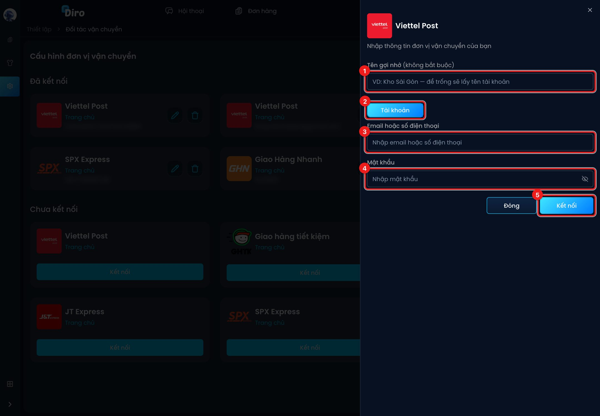
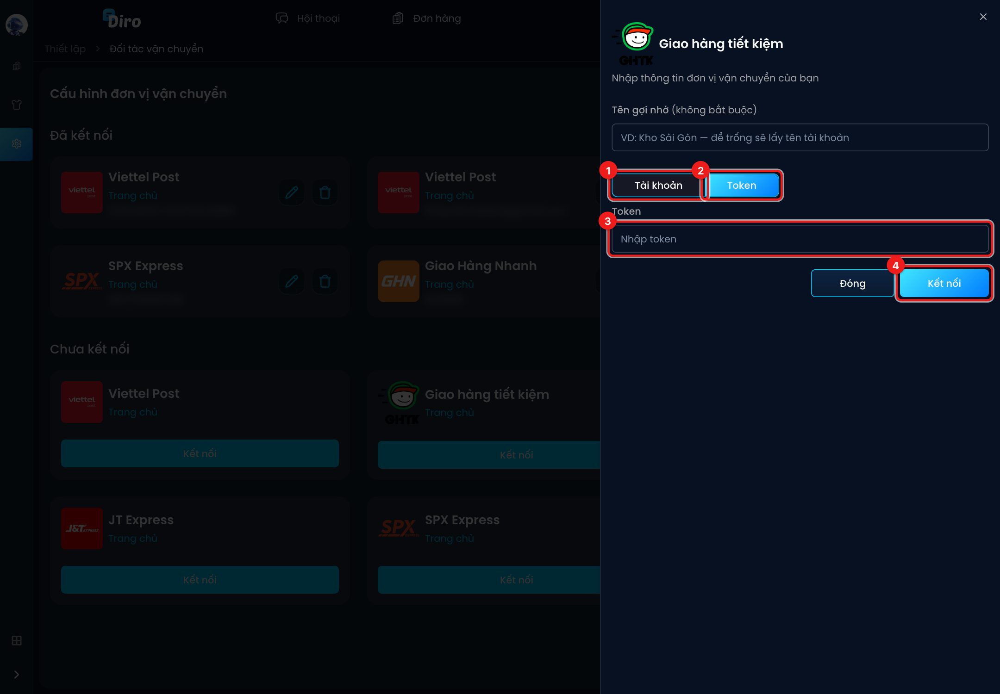
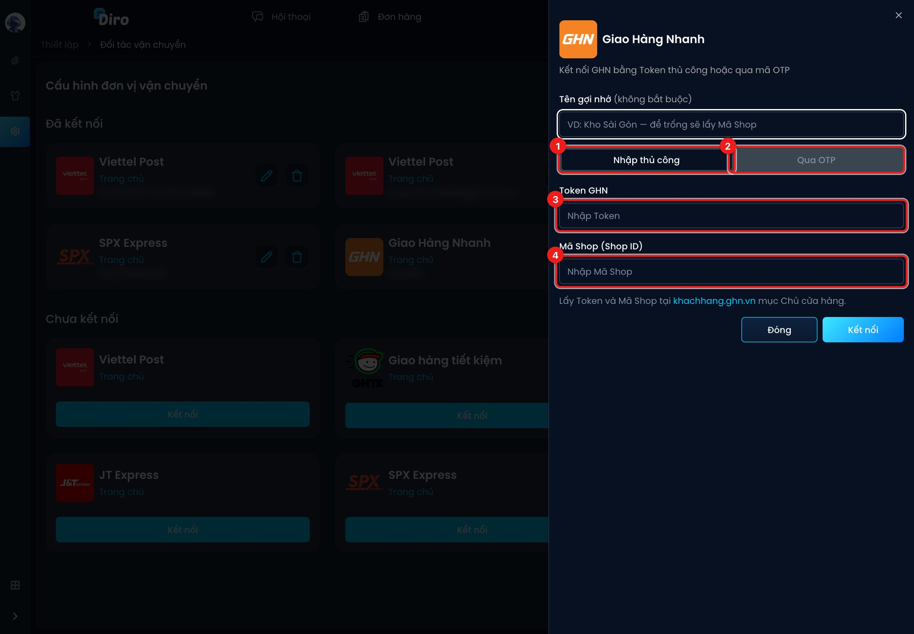
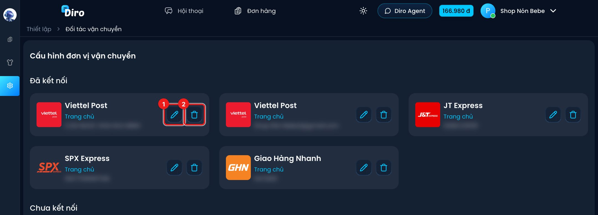

# Kết nối đơn vị vận chuyển

Muốn tạo vận đơn từ Diro, bạn cần kết nối tài khoản của hãng vận chuyển trước. Mỗi hãng
cần một bộ thông tin khác nhau, mô tả bên dưới. Bạn kết nối một lần, sau đó mọi trang
trong tài khoản đều dùng được.

:::info Ai được kết nối?
Chỉ **chủ tài khoản** mới kết nối, đổi tên hay xoá được tài khoản hãng. Nhân viên chỉ chọn
được tài khoản hãng của chủ khi gửi đơn.
:::

## Mở trang Đối tác vận chuyển

Vào **Thiết lập → Vận chuyển → Đối tác vận chuyển**. Trang có hai phần:

- **Đã kết nối**: các tài khoản hãng bạn đã kết nối.
- **Chưa kết nối**: các hãng Diro hỗ trợ, mỗi hãng có nút **Kết nối**.

1. Bấm **Kết nối** ở thẻ của hãng bạn muốn dùng. Một khung nhập thông tin mở ra bên phải.

Thẻ **VNPost** đang khoá nút Kết nối vì Diro chưa hỗ trợ hãng này.

:::tip Kết nối nhiều tài khoản cùng một hãng
Bạn kết nối được nhiều tài khoản của cùng một hãng, ví dụ hai tài khoản SPX cho hai kho.
Hãy đặt **Tên gợi nhớ** (như "Kho Sài Gòn") để phân biệt khi gửi đơn. Bỏ trống thì Diro
lấy tên tài khoản (hoặc Mã Shop với GHN) làm tên. Diro chỉ chặn khi bạn kết nối lại đúng
tài khoản đã có.
:::

## SPX Express

1. **Tên gợi nhớ** (không bắt buộc).
2. **Mã người dùng**.
3. **Secret Key**.
4. Bấm **Kết nối**.

Lấy **Mã người dùng** và **Secret Key** trên trang web SPX: **Cửa hàng → Hồ sơ shop**, hoặc
mở thẳng `https://spx.vn/spx-admin/account/profile`. Diro kiểm tra hai thông tin này với SPX
trước khi lưu.

## J&T Express

1. **Tên gợi nhớ** (không bắt buộc).
2. **Mã khách hàng (customerCode)**.
3. **Key**.
4. Bấm **Kết nối**.

**Mã khách hàng** và **Key** không có sẵn trên web J&T. Bạn hỏi bộ phận Sales hoặc bưu cục
nơi bạn ký hợp đồng với J&T. Diro thử báo giá một đơn mẫu để kiểm tra thông tin đúng hay sai.

## Viettel Post

1. **Tên gợi nhớ** (không bắt buộc).
2. Chọn thẻ **Tài khoản**.
3. **Email hoặc số điện thoại** bạn dùng để đăng nhập Viettel Post.
4. **Mật khẩu** Viettel Post.
5. Bấm **Kết nối**.

Diro đăng nhập thử vào Viettel Post bằng thông tin này. Sai thì sẽ báo **Thông tin kết nối
không chính xác**.

## Giao Hàng Tiết Kiệm (GHTK)

GHTK có hai cách kết nối:

1. Thẻ **Tài khoản**: nhập **Email** và **Mật khẩu** đăng nhập GHTK.
2. Thẻ **Token**: dán token lấy từ trang quản lý của GHTK.
3. Ô **Token** (khi chọn thẻ Token).
4. Bấm **Kết nối**.

:::caution
Diro **không kiểm tra** token dán tay. Dán sai token thì vẫn kết nối được, nhưng tới lúc gửi
đơn mới báo lỗi. Nếu không chắc, hãy dùng cách đăng nhập bằng Email.
:::

## Giao Hàng Nhanh (GHN)

GHN cũng có hai cách:

1. **Nhập thủ công**: nhập Token và Mã Shop.
2. **Qua OTP**: nhập số điện thoại chủ shop GHN, bấm **Nhận mã OTP**, rồi nhập **Mã OTP** và
   **Mã Shop GHN** và bấm **Kết nối**.
3. **Token GHN** (cách nhập thủ công).
4. **Mã Shop (Shop ID)** (cách nhập thủ công).

Lấy Token và Mã Shop tại `khachhang.ghn.vn`, mục **Chủ cửa hàng**.

## Sửa tên gợi nhớ hoặc xoá tài khoản đã kết nối

1. Bút chì: **Sửa tên gợi nhớ**.
2. Thùng rác: xoá tài khoản hãng. Diro hiện ô xác nhận ở góc trên bên phải, bấm vào biểu
   tượng thùng rác trong ô đó để xoá.

Xoá tài khoản hãng **không làm hỏng** các vận đơn đã tạo. Trạng thái của chúng vẫn tiếp tục
được cập nhật. Sau này bạn kết nối lại đúng tài khoản đó thì Diro khôi phục như cũ.

## Câu hỏi thường gặp

**Kết nối báo "Nhà vận chuyển đã tồn tại"?**
Tài khoản đó đã được kết nối rồi. Hãy tìm nó ở phần **Đã kết nối**.

**Báo "Thông tin kết nối không chính xác"?**
Kiểm tra lại từng ký tự. Với SPX và J&T, hãy copy nguyên văn từ trang của hãng, đừng gõ tay.
