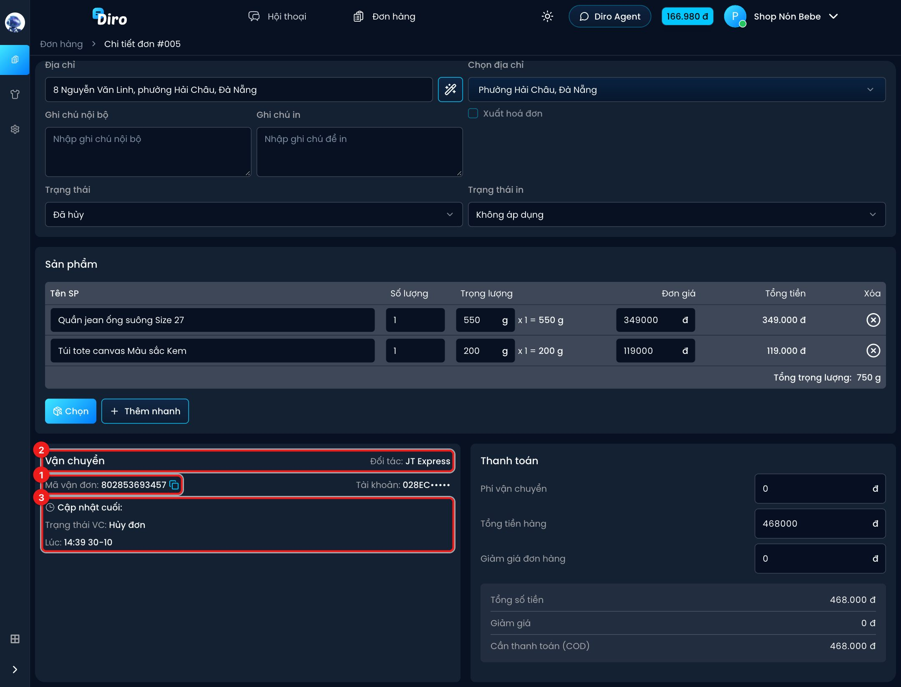

# Theo dõi trạng thái và hoàn hàng

Sau khi gửi đơn sang hãng, bạn không phải cập nhật trạng thái bằng tay. Mỗi lần hãng quét
đơn (lấy hàng, đang giao, giao xong, hoàn…), Diro nhận tin và tự đổi trạng thái đơn.

## Trạng thái đơn tự cập nhật

Các thẻ trạng thái trên trang **Đơn hàng** đi theo hành trình giao:

| Trạng thái trên Diro | Khi nào |
|---|---|
| **Chờ lấy hàng** | Vừa tạo vận đơn, bưu tá chưa lấy hàng |
| **Đang vận chuyển** | Hãng đã lấy hàng, đang chuyển hoặc đang đi giao |
| **Chờ xử lý đơn** | Giao không thành, hãng đang giữ hàng chờ shop quyết định (SPX và GHN) |
| **Đã giao hàng** | Khách đã nhận hàng |
| **Đã thu tiền** | Hãng đã đối soát tiền thu hộ (chỉ GHTK tự cập nhật; hãng khác bạn tự chuyển) |
| **Đang trả hàng** | Hàng đang trên đường hoàn về shop |
| **Đã trả hàng một phần** | Khách nhận một phần, phần còn lại hoàn về (GHTK tự cập nhật) |
| **Đã trả hàng** | Hàng đã hoàn về shop |
| **Đã hủy** | Vận đơn bị huỷ, ở Diro hoặc ở phía hãng |

Cách Diro nhận tin:

- **SPX, J&T, Viettel Post, GHTK**: hãng báo về ngay mỗi khi có thay đổi. Riêng SPX hay báo
  theo lô, nên có thể trễ vài phút tới vài chục phút so với lúc bưu tá quét.
- **GHN**: Diro tự hỏi GHN **10 phút một lần**, nên trạng thái GHN có thể trễ tới 10 phút.

Diro không bao giờ tự đưa đơn về **Mới**, **Đã xác nhận** hay **Đang đóng hàng**. Tin báo tới
trễ mà làm trạng thái đi lùi thì Diro bỏ qua. Trạng thái **Chờ xử lý đơn** do hãng quyết định,
bạn không chọn tay được.

## Xem mã vận đơn và chi tiết vận đơn

Đơn đã gửi có mã vận đơn trong cột **Mã vận đơn** của danh sách đơn. Rê chuột vào mã để
copy. Bạn cũng tìm được đơn bằng mã vận đơn ở ô **Mã đơn / Mã vận đơn**.

Mở chi tiết đơn, phần **Vận chuyển** hiện tên hãng, mã vận đơn, tài khoản hãng, và
**Cập nhật cuối** gồm trạng thái vận chuyển, vị trí, thời gian và ghi chú của hãng.

1. **Mã vận đơn** — bấm biểu tượng bên cạnh để copy.
2. **Đối tác** và **Tài khoản** — hãng và tài khoản hãng đã dùng để tạo vận đơn.
3. **Cập nhật cuối** — trạng thái mới nhất hãng báo về (ví dụ trong ảnh là vận đơn vừa bị huỷ).

Với đơn **SPX**, mã vận đơn có màu xanh. Bấm vào mã để mở **Chi tiết vận đơn SPX**: trạng
thái, SĐT bưu tá, người nhận, địa chỉ, tiền thu hộ, cân nặng và kích thước SPX đang ghi nhận.
Các hãng khác chưa có khung chi tiết này.

## SĐT bưu tá

Diro lưu số điện thoại bưu tá đi giao khi hãng gửi kèm trong tin báo trạng thái:

| Hãng | Có SĐT bưu tá? |
|---|---|
| SPX | Có, từ lúc đang giao hoặc khi hàng bị tạm giữ |
| J&T | Có, ở các lần quét đi giao / giao xong |
| Viettel Post | Có, ở các trạng thái đi giao / giao xong |
| GHN | Có |
| GHTK | Không |

Số bưu tá được dùng ở:

- Khung **Chi tiết vận đơn SPX** (dòng **SĐT của bưu tá giao hàng**).
- Biến **`{SDT_BUU_TA}`** trong mẫu tin nhắn. Diro thay biến này bằng SĐT bưu tá của đơn gần
  nhất trong hội thoại. Nếu chưa có số bưu tá, tin không được gửi.
- Tìm đơn theo SĐT bưu tá ở ô tìm kiếm đơn hàng.

## Huỷ vận đơn

- Huỷ đơn trên Diro khi đơn đang **Chờ lấy hàng** thì Diro **huỷ luôn vận đơn bên hãng** (cả
  5 hãng).
- Khi hãng đã lấy hàng, Diro không huỷ được vận đơn nữa. Bạn cần liên hệ hãng để chặn giao
  hoặc hoàn hàng.
- Ngược lại, nếu vận đơn bị huỷ ở phía hãng, đơn trên Diro cũng tự chuyển **Đã hủy**.

## Hoàn hàng

- Khi hãng báo hoàn, đơn chuyển **Đang trả hàng**, rồi **Đã trả hàng** khi hàng về tới shop.
- Khách có đơn **Đã trả hàng** được Diro đánh dấu là từng bom hàng, giúp bạn cảnh giác ở lần
  mua sau.
- **Giao 1 phần** với SPX và J&T không có trạng thái riêng. Bạn kiểm tra trên trang của hãng
  và tự chuyển trạng thái nếu cần.
- Diro không tự cộng lại tồn kho khi hàng hoàn về.

## Tiền thu hộ thay đổi bên hãng

Nếu bạn sửa tiền thu hộ (COD) trên app của hãng, Diro tự cập nhật lại tổng tiền đơn cho khớp
(Viettel Post, SPX, GHTK, GHN). Phần tiền giảm được ghi thành giảm giá. J&T không báo lại COD
nên với J&T bạn phải sửa đơn trên Diro bằng tay.
